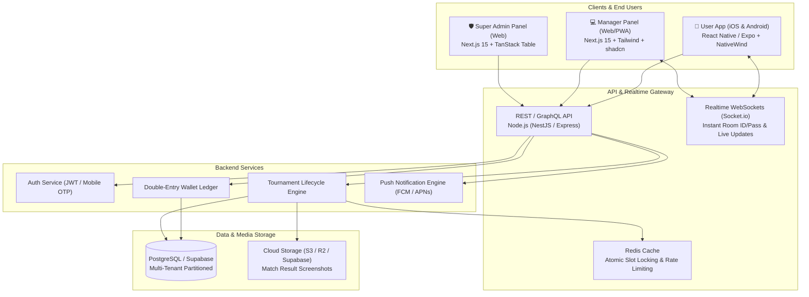
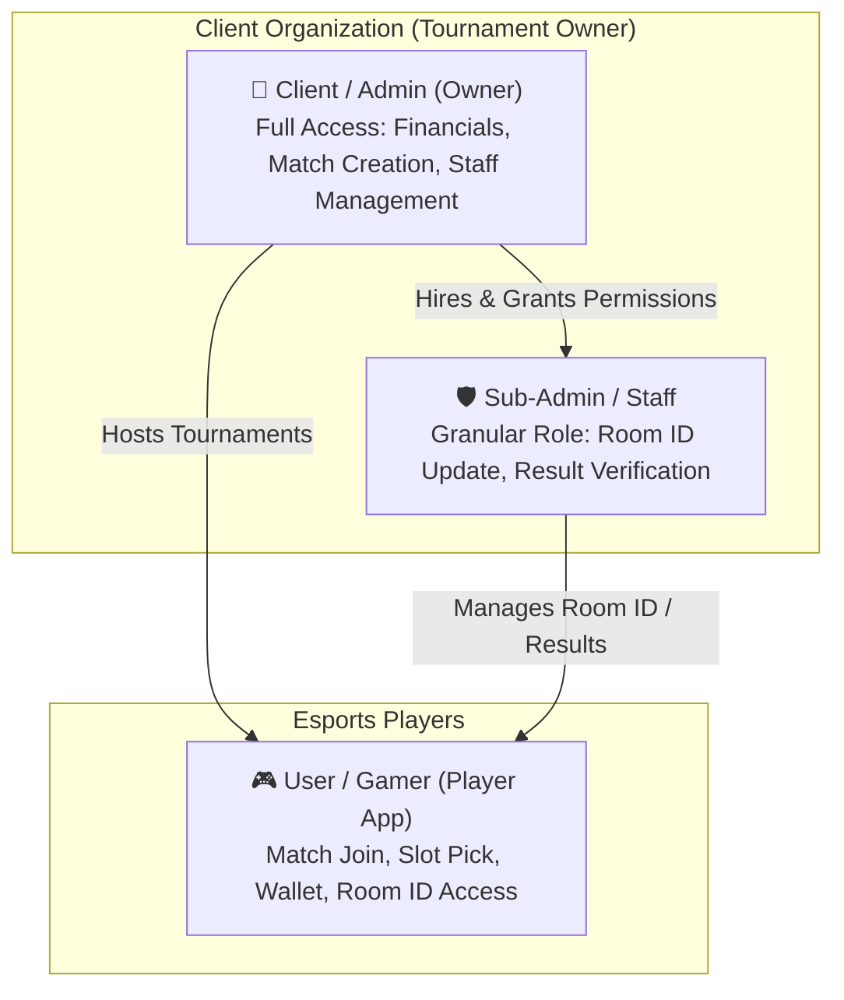

# 🎮 Free Fire Tournament Platform - Master Roadmap & Architecture Plan

> **Project Concept:** Multi-Tenant / White-Label Esports Tournament SaaS Platform (Exclusively for Free Fire & Free Fire MAX)  
> **Source Directives:** WhatsApp Requirements Discussion with Boss (`boss demand/WP.txt`)  
> **Author:** Jay Kumar  
> **Target Form Factor:** iOS-style Modern Mobile App (Player Panel) + Modern Responsive Web Dashboards (Admin & Manager Panels)  
> **Theme Support:** Native Dual Theme (Deep Dark Mode & Clean Light Mode)

---

## 📌 1. Executive Summary & Boss Requirements Breakdown

Boss ki chat (`WP.txt`) ke basis par key points aur business model:

| Boss Requirement | Technical Interpretation | Implementation Strategy |
| :--- | :--- | :--- |
| **"Multiple clients ko sell karna hai"** | **Multi-Tenant / White-Label SaaS Architecture** | Ek centralized backend jisme har client (Tournament Organizer) apna sub-brand, custom logo, payment gateway aur matches chala sake. Database level par `tenant_id` isolation. |
| **"Html se bas mat banana... React me pura app"** | **Modern Component-Driven Tech Stack** | Mobile App: **React Native (Expo SDK / Bare)** ya **Flutter** (iOS native feeling ke liye). Web Panels: **Next.js / React + Tailwind CSS + shadcn/ui**. |
| **"iOS / iPhone app ke jaisa modern UI"** | **Cupertino / Glassmorphic Design System** | Rounded cards (16px/24px radius), subtle blur/glassmorphism, smooth spring micro-animations, bottom sheets, floating navigation bar. |
| **"Light mode dark mode rakhna"** | **System & Manual Theme Switcher** | Tailored Dark Gaming Theme (OLED Black + Neon Violet/Orange accents) aur Clean Light Theme (Apple Slate Grey + Crisp White). |
| **"3 Panels: Admin, Manager, User"** | **Role-Based Access Control (RBAC)** | 1. **Super Admin Panel** (Platform Owner)<br>2. **Manager Panel** (Client/Organizer)<br>3. **User App** (Free Fire Gamers) |
| **"Feature advance banana, security me dekh lunga"** | **High-Tech Tournament Engine** | Anti-fraud slot booking, auto-wallet ledger, room credentials timed delivery, screenshot result upload, commission payout automation. |
| **"Banate time preview dikhate rehna"** | **CI/CD & Live Staging Links** | Expo Go / Web Preview deployments har phase ke end par boss ko live review karwane ke liye. |

---

## 🏗️ 2. High-Level Architecture & Tech Stack Recommendation



### Recommended Technology Stack:
1. **Mobile App (Player Panel)**:
   - **Framework:** **React Native with Expo** (TypeScript) + **NativeWind (Tailwind CSS for React Native)**.
   - **UI Polish:** `@gorhom/bottom-sheet`, `react-native-reanimated`, `expo-haptics`, `lucide-react-native`, `expo-blur`.
   - **Why?** Boss ne React approve kiya hai, aur Expo se directly iOS aur Android dono par 100% iPhone-style fluid UI banti hai bina alag-alag Swift/Kotlin likhe.

2. **Manager & Super Admin Dashboards (Web)**:
   - **Framework:** **Next.js 15 (App Router)** or **Vite + React**.
   - **UI Library:** **shadcn/ui** (Radix UI primitives) + **Tailwind CSS** + **Lucide Icons** + **Tremor Charts**.
   - **State & Tables:** `@tanstack/react-query` + `@tanstack/react-table`.

3. **Backend & Cloud Architecture: Smart Hybrid Model (Firebase + Supabase)**:
   - **The Smart Hybrid Approach (Recommended):**
     * **Firebase Auth & FCM:** Free Fire players ke fast Mobile Number + OTP Login ke liye Firebase Authentication, aur Match start hone se 15 min pehle Room ID/Password ka high-priority device notification bhejne ke liye **Firebase Cloud Messaging (FCM)**.
     * **Supabase (Managed PostgreSQL):** Core relational database, multi-tenant isolation, Prisma ORM connectivity, double-entry wallet ledger, aur screenshot image storage ke liye **Supabase Storage**.
     * **Realtime Layer:** Supabase Realtime / Socket.io for instant live slot updates and in-app room revealing.
     * **In-Memory Cache & Mutex:** **Redis (Upstash / Redis)** slot booking me high concurrency race condition prevent karne ke liye.
   - **Alternative (Pure Firebase):**
     * Agar boss strictly 100% Firebase chahte hain: **Cloud Firestore + Firebase Auth + Firebase Storage + Cloud Functions (Node.js)**. (Note: Firestore me slot booking ke waqt concurrency limit ka dhyan rakhna padega).

---

## 👥 3. Updated Role-Based Architecture (As per Boss Demand: `poss demand..md`)

> **Key Pivot:** Hamare (Jay & Boss) ke liye alag se koi platform Super Admin panel nahi banega. Jo client humse app lega, wahi **Admin (Manager/Owner)** hoga. Aur wo apne kaam ke liye jo bande hire karega, wo **Sub-Admin (Staff/Moderator)** honge.



### 👑 Role 1: Admin App (The Client / Tournament Owner)
*Ye app us client ko milega jo tournament system kharid raha hai.*
- **Full Business Control:** Total matches hosted, entry fee revenue, net profit, pending withdrawal requests.
- **Staff Management (Sub-Admin Creation):** 
  - Naye staff member ko add karna (Email, Password) aur specific permissions dena:
    * `canCreateMatch`: Boolean (Naya match create kar sakta hai ya nahi)
    * `canUpdateRoomId`: Boolean (Custom Room ID/Pass update karne ka haq)
    * `canDistributePrize`: Boolean (Winner ko paise distribute karne ka haq)
    * `canManageWallet`: Boolean (Deposit/Withdrawal approve karne ka haq)
- **Tournament Control:** Match creation (Solo/Duo/Squad/CS), map selection, entry fee, prize pool, cancellation & auto-refund.
- **Financial Settings:** Apna personal UPI ID, QR code, payment gateway keys, aur WhatsApp support number configure karna.

---

### 🛡️ Role 2: Sub-Admin (Staff / Moderator App - Same Admin APK)
*Ye wahi Admin app hai, lekin staff jab login karega toh unhe sirf wahi buttons/cards dikhenge jinki permission Admin ne di hai.*
- **Dynamic Jetpack Compose Dashboard:**
  - Agar `canUpdateRoomId == true` hai, toh Room ID input box open hoga.
  - Agar `canDistributePrize == true` hai, toh Result & Screenshot review section dikhega.
  - Financial data aur Staff add karne ke rights inke paas **nahi** honge.

---

### 🎮 Role 3: Player Mobile App (Kotlin + Jetpack Compose)
*Free Fire gamers ke liye dedicated client-branded app.*
- **1-Tap Google / Phone Auth:** Firebase Auth + Free Fire UID aur In-Game Name (IGN) mandatory setup.
- **Match Feed & Slot Selector:** Bermuda, Purgatory, Kalahari matches with live filled slots counter (e.g. 38/48).
- **Protected Room ID View:** Match time se 15 min pehle countdown khatam hone par Room ID aur Password unlock hona (sirf registered slot holders ke liye).
- **Dual Wallet:** Deposit balance (for joining) + Winning balance (withdrawable to UPI).
- **Result Proof Upload:** End-game scorecard screenshot upload for kill verification.

---

## 📱 3.1 Android Studio Multi-Module Architecture (Kotlin + Jetpack Compose)

```
FreeFireTourneyApp/
├── :app-player      # Player APK (Gamer UI, Slot Picker, Room ID, Wallet)
├── :app-admin       # Admin & Staff APK (Role == "admin" vs "sub_admin" dynamic Compose screens)
└── :core            # Shared Kotlin Data Classes (Tournament.kt, User.kt, Permissions.kt) & Supabase/Firebase Repositories
```

### ⏱️ 10-Minute Client Handover Model:
Har naye client ke aane par sirf ye 4 steps karne honge:
1. Client ke Supabase/Firebase credentials project me connect karna.
2. `build.gradle.kts` me Client ka App Name, Package Name (`com.client.player`), aur Theme Colors update karna.
3. Client ka Logo mipmap me daalna.
4. Android Studio se 2 signed APK generate karna (`Player.apk` aur `Admin.apk`) aur client ko de dena!
  - Match Card UI: Match Banner, Map Name, Prize Pool, Per Kill Reward, Entry Fee, Available Slots Progress Bar (e.g., 38/48 Joined).
- **Interactive Slot Selector:**
  - Solo ke liye direct entry; Squad ke liye Slot 1 se Slot 12 tak seat map (kaun sa squad slot khali hai dekh kar select karna).
  - Team Code generation to invite friends directly into the squad slot.
- **Match Room Locker (Security Feature):**
  - Match start hone se 15 min pehle countdown timer.
  - Jaise hi manager Room ID & Password dale, instant Push Notification + Copy Room ID & Password one-click button.
- **Wallet System:**
  - Balance Split: **Deposit Cash** | **Winnings Cash** | **Bonus Coins**.
  - Add Money via UPI (GPay, PhonePe, Paytm).
  - Instant Withdrawal request to UPI / Bank Account with status tracking (Pending -> Approved -> Success).
- **Result & Proof Submission:**
  - Match khatam hone ke baad end screen screenshot upload karne ka section (kill proof aur booyah proof).
- **Social & Gamification:**
  - Leaderboard (Top Earners, Top Fraggers of the Month).
  - Refer & Earn system (Referral code to earn bonus entry coins).
  - Dual Theme: OLED Dark Mode (Default gaming feel) / Cupertino Light Mode.

---

## 🗄️ 4. Multi-Tenant Database Schema Blueprint

```sql
-- 1. Tenants (Clients / Organizers)
CREATE TABLE tenants (
    id UUID PRIMARY KEY DEFAULT gen_random_uuid(),
    name VARCHAR(100) NOT NULL,
    slug VARCHAR(50) UNIQUE NOT NULL, -- e.g. "jharkhand-esports"
    logo_url TEXT,
    branding_colors JSONB, -- { "primary": "#FF5722", "darkBg": "#0A0A0C" }
    status VARCHAR(20) DEFAULT 'ACTIVE',
    commission_rate DECIMAL(5, 2) DEFAULT 10.00, -- Platform cut %
    created_at TIMESTAMP WITH TIME ZONE DEFAULT NOW()
);

-- 2. Users (Players across tenants)
CREATE TABLE users (
    id UUID PRIMARY KEY DEFAULT gen_random_uuid(),
    tenant_id UUID REFERENCES tenants(id) ON DELETE CASCADE,
    phone VARCHAR(20) NOT NULL,
    name VARCHAR(100),
    ff_ign VARCHAR(50) NOT NULL, -- Free Fire In-Game Name
    ff_uid VARCHAR(30) NOT NULL, -- Free Fire Numeric UID
    role VARCHAR(20) DEFAULT 'PLAYER', -- 'SUPERADMIN', 'MANAGER', 'PLAYER'
    wallet_deposit DECIMAL(10,2) DEFAULT 0.00,
    wallet_winnings DECIMAL(10,2) DEFAULT 0.00,
    wallet_bonus DECIMAL(10,2) DEFAULT 0.00,
    is_banned BOOLEAN DEFAULT FALSE,
    created_at TIMESTAMP WITH TIME ZONE DEFAULT NOW(),
    UNIQUE(tenant_id, phone),
    UNIQUE(tenant_id, ff_uid)
);

-- 3. Tournaments
CREATE TABLE tournaments (
    id UUID PRIMARY KEY DEFAULT gen_random_uuid(),
    tenant_id UUID REFERENCES tenants(id) ON DELETE CASCADE,
    created_by UUID REFERENCES users(id),
    title VARCHAR(150) NOT NULL,
    match_type VARCHAR(20) NOT NULL, -- 'SOLO', 'DUO', 'SQUAD', 'CS_4V4'
    map_type VARCHAR(50) NOT NULL, -- 'BERMUDA', 'PURGATORY', 'KALAHARI', 'ALPINE'
    entry_fee DECIMAL(10, 2) NOT NULL DEFAULT 0.00,
    prize_pool DECIMAL(10, 2) NOT NULL,
    per_kill_prize DECIMAL(10, 2) DEFAULT 0.00,
    total_slots INT NOT NULL DEFAULT 48,
    match_time TIMESTAMP WITH TIME ZONE NOT NULL,
    room_id VARCHAR(50),
    room_password VARCHAR(50),
    room_released_at TIMESTAMP WITH TIME ZONE,
    status VARCHAR(30) DEFAULT 'UPCOMING', -- 'UPCOMING', 'OPEN', 'ONGOING', 'VERIFYING', 'COMPLETED', 'CANCELLED'
    rules_notes TEXT,
    created_at TIMESTAMP WITH TIME ZONE DEFAULT NOW()
);

-- 4. Tournament Participants & Slot Booking
CREATE TABLE tournament_participants (
    id UUID PRIMARY KEY DEFAULT gen_random_uuid(),
    tournament_id UUID REFERENCES tournaments(id) ON DELETE CASCADE,
    user_id UUID REFERENCES users(id),
    slot_number INT NOT NULL, -- 1 to 48 or Team 1-12
    team_name VARCHAR(50),
    kills INT DEFAULT 0,
    rank INT DEFAULT 0,
    prize_won DECIMAL(10, 2) DEFAULT 0.00,
    screenshot_proof_url TEXT,
    is_verified BOOLEAN DEFAULT FALSE,
    created_at TIMESTAMP WITH TIME ZONE DEFAULT NOW(),
    UNIQUE(tournament_id, slot_number),
    UNIQUE(tournament_id, user_id)
);

-- 5. Wallet Ledger (Strict Double-Entry Records)
CREATE TABLE wallet_transactions (
    id UUID PRIMARY KEY DEFAULT gen_random_uuid(),
    tenant_id UUID REFERENCES tenants(id),
    user_id UUID REFERENCES users(id) ON DELETE CASCADE,
    tournament_id UUID REFERENCES tournaments(id),
    amount DECIMAL(10,2) NOT NULL,
    type VARCHAR(30) NOT NULL, -- 'DEPOSIT', 'ENTRY_FEE', 'WINNING_PAYOUT', 'WITHDRAWAL', 'REFUND', 'BONUS'
    status VARCHAR(20) DEFAULT 'SUCCESS', -- 'PENDING', 'SUCCESS', 'FAILED'
    reference_id VARCHAR(100), -- Gateway Transaction ID / UTR
    notes TEXT,
    created_at TIMESTAMP WITH TIME ZONE DEFAULT NOW()
);
```

---

## 🗓️ 5. Step-by-Step Implementation Phases (7-Phase Roadmap)

### 📍 Phase 1: Foundation & Multi-Tenant Database Setup (Days 1–3)
- [ ] Initialize monorepo or standard folder structure (`/mobile-app`, `/admin-web`, `/backend-api`).
- [ ] Set up PostgreSQL database with Multi-Tenant schema (Tenants, Users, Tournaments, Slots, Ledger).
- [ ] Docker container setup for local DB + Redis.
- [ ] Seed script ready with demo tenant (e.g., "Apex Free Fire Club") and demo tournaments.

### 📍 Phase 2: Authentication & Core API Service (Days 4–7)
- [x] Multi-tenant Auth service (JWT tokens with `tenant_id` and `role` claims).
- [x] Phone OTP login flow + Free Fire UID & In-game name capture (Firebase Auth wired for dev).
- [x] Role Guards: SuperAdmin, Manager, and Player middleware.
- [ ] Swagger / Postman API documentation auto-generation for testing.

#### 🎯 Production Cost-Optimization Milestone: Indian SMS Gateway Cutover (Fast2SMS / 2Factor / PIN)
> **Financial Risk Analysis:**  
> Firebase Identity Platform routes SMS via international telecom gateways, billing ~$0.07 USD (~₹5.80–₹6 per SMS) in India with only 10 daily free SMS on live traffic. At 10,000 monthly OTPs, Firebase incurs a devastating ~₹60,000 bill.  
> **Production Cutover Action Items:**
> 1. **Current Development Phase:** Kept on Firebase Auth using configured **Test Phone Numbers** (`+91 9999900001` -> `123456`, `+91 9999900003` -> `123456`) which consume **₹0 quota** for unlimited dev/UI testing.
> 2. **Production Option 1 — Domestic Indian SMS Gateway (Fast2SMS / 2Factor / MSG91):**
>    - Direct DLT-registered local A2P route costing **₹0.15 to ₹0.25 (15–25 paise) per OTP**.
>    - 10,000 OTPs cost only **~₹1,800** (saving ~₹58,000/month!).
>    - Simple Node.js backend REST call to send 4/6-digit OTP and verify in Redis cache (5-min TTL).
> 3. **Production Option 2 — Phone + 4-Digit Security PIN / Password (₹0 Cost Model):**
>    - Gamer sets a 4-digit PIN upon registration.
>    - All future logins use Phone + PIN directly against bcrypt hash in DB.
>    - **Zero SMS cost forever (₹0)**, zero dependency on telecom gateways, instant login with 0 delay.
> 4. **Production Option 3 — Hybrid Architecture (Recommended for Scale):**
>    - Initial registration + Password reset uses Indian SMS Gateway (Fast2SMS ~18 paise).
>    - Daily logins use Phone + PIN or Persistent DataStore JWT session (already built in core).

### 📍 Phase 3: Tournament Engine & Race-Condition Proof Slot Booking (Days 8–12)
- [x] Match creation endpoints with Free Fire presets (Bermuda/Purgatory, Solo/Duo/Squad, Gun Prop off, etc.).
- [x] **Atomic Slot Reservation with Redis:** Prevent two players from booking the same slot at the exact same millisecond.
- [x] Squad invitation flow (leader generates 6-digit squad join code for teammates).
- [x] Automatic entry fee deduction from User Wallet.
- [x] Cancel tournament + auto-refund all players (ledger double-entry verified).
- [x] e2e race test: 20 concurrent joins on last 2 seats -> exactly 2 granted, SLOTS_FULL at 48.

### 📍 Phase 4: Room ID Delivery & Match Day Automation (Days 13–16)
- [x] Manager Room ID & Password input API (PATCH /room, ROOM_REVEALED status).
- [x] Timed room release: players see creds only from T-15min (403 countdown lock).
- [x] Player screenshot result submission + verify (MatchResult upsert).
- [x] 1-Click winner payout: per-kill + rank prize -> winningBalance -> double-entry ledger -> COMPLETED.
- [x] WebSocket realtime channel (`src/services/realtime.service.ts`, `/ws`): room creds, match status, wallet + payout events; token auth handshake, PING/PONG keep-alive, per-user / per-tenant fan-out (tests: `tests/realtime.test.ts`).
- [x] Push Notifications via Firebase Cloud Messaging (`src/services/fcm.service.ts`, token stored on `User.fcmToken`).
- [x] Match status state machine + minute sweep (`matchSweep.service.ts`): OPEN to SLOTS_FULL to ROOM_REVEALED (T-15 min) to LIVE (kickoff) to UNDER_REVIEW (kickoff + 2h) to COMPLETED (tests: `tests/matchSweep.test.ts`).

### 📍 Phase 5: Result Processing, Screenshot Verification & Wallet Ledger (Days 17–21)
- [x] Official result capture: `MatchResult.screenshotUrl` (official/spectator screenshot link) plus per-player kills/rank/DQ, locked after payout.
- [x] Admin review surface: scoreboard order, publish results, 1-tap payout confirmation (admin app result screen).
- [x] 1-Click Winner Payout: rank split 50/30/20 % of pool plus per-kill bonus into `winningBalance`, double-entry ledger, status COMPLETED (tests: `finishMatchPayout.test.ts`, `resultLifecycle.test.ts`).
- [x] 1-Click Match Cancellation & Auto-Refund to every participant (fee returns to the balance it came from, exactly once) - `cancelRefund.test.ts`.
- [x] Withdrawal request management (Approve/Reject with UTR reference, refund on reject) - `withdrawalService.test.ts`, admin wallet console.
- [ ] Player-side screenshot upload to Cloud Storage (deliberately skipped: results are official/spectator-verified, see schema note).

### 📍 Phase 6: iOS-Style UI/UX & Native Polish (Days 22–27)
- [x] Native Android equivalent of the Cupertino look (this stack is Kotlin/Compose, not Expo):
  frosted `GlassCard`, modal bottom sheets (`AddMoneySheet`, `PlayerBottomSheet`), ripple/haptic press feedback.
- [x] Complete **Dark Mode** design tokens (dark-only product decision) with readable surfaces - fixed the dark-theme `Surface` regression.
- [x] Clean card layouts, tournament countdown timers, live slot counter bars, wallet screen and admin wallet console.
- [x] Deployable web preview of the design (`ui-ux demo/finel demo`, Vite) for client review.
- [x] Player wallet top-up UX: Add Money sheet, amount chips, gateway handoff, pending/success/failure states.

### 📍 Phase 7: Multi-Client White-Label Engine & Security Hardening (Days 28–30) — ✅ COMPLETE
- [ ] Dynamic branding injector: Logo, primary colors, and app name load dynamically based on Tenant configuration.
- [ ] Security hardening:
  - Device ID fingerprinting to block multiple accounts per device.
  - Rate limiting on sensitive wallet and slot-booking endpoints.
  - SQL injection & XSS sanitization.
- [x] Final end-to-end testing (Solo, Duo, Squad tournament lifecycle from creation to cash withdrawal).
- [x] 48-Player Concurrency Stress Suite passed with 0 errors (`scripts_stress_test.ts`).
- [x] Daily Settlement Console & 1-Tap Match Cloning presets.

### 📍 Phase 8: Production Cloud Deployment & Custom Domain (Active)
- [x] Multi-stage production `Dockerfile` (non-root user) plus `.dockerignore` and Prisma generate at build time.
- [ ] Cloud deployment to Render / Railway / VPS / Cloud Run.
- [ ] Connect production Upstash Serverless Redis & Supabase pooler (Port 6543).
- [ ] Custom domain DNS mapping (`api.yourbrand.com`) with automated SSL/TLS certificates.
- [ ] Android apps (`:app-player` & `:app-admin`) switch from `localhost:5000` to live HTTPS domain.
- [ ] Refer to comprehensive plan: `plan/PRODUCTION_CLOUD_DEPLOYMENT_PLAN.md`.

### 📍 Phase 9: Real-Money Payments & Wallet Top-Up - ✅ COMPLETE
> Source of truth: `docs/PAYMENT_GATEWAY.md`.
> Tests: `paymentGateway.test.ts`, `paymentSettlement.test.ts`, `adminPayments.test.ts`,
> `authAndWebhook.e2e.test.ts`, `paymentGatewayRazorpay.test.ts`.

- [x] **Razorpay provider** (UPI / cards / netbanking / wallets) over REST with Node 22 `fetch` - no SDK dependency; a `mock` provider keeps local demos keyless.
- [x] **All money in integer paise** on the money path (no floats, no rounding drift).
- [x] `PaymentOrder` model + `PaymentStatus` enum (CREATED to AUTHORIZED to CAPTURED / FAILED / EXPIRED), unique `providerOrderId` + `receipt`, TTL-bound `expiresAt`.
- [x] Create order then client checkout then `/verify` signature check then **CAPTURED** then deposit credit **exactly once**.
- [x] **Razorpay webhook** (`payment.captured` / `payment.failed`) verified against the **raw request body** bytes (HMAC-SHA256), idempotent retries, unknown-order handling.
- [x] Settlement is **claim-then-credit** (`updateMany where status != CAPTURED`), so a late success or a duplicated webhook can never create money twice.
- [x] Expiry sweep (`PAYMENT_EXPIRY_SWEEP_INTERVAL_MS`) marks stale orders EXPIRED; a genuine late capture still settles.
- [x] **Reconcile** (`reconcilePaymentOrder`) shared by player and admin: asks the gateway what really happened, then settles through the same idempotent path.
- [x] Ledger row `DEPOSIT`, realtime `WALLET_UPDATED` and `DEPOSIT_APPROVED` fan-out.
- [x] Config with boot assertions: `PAYMENT_PROVIDER`, min/max amount clamps, order TTL, `PUBLIC_BASE_URL`; `mock` in production is a warning, never a crash.
- [x] Player Android: `AddMoneySheet` + `WalletScreen` + Razorpay checkout listener in `MainActivity`, amount chips, pending/failed recovery.
- [x] Admin Android: **Online** tab inside the Wallet Console - collected today, all-time, status filters, per-order **Sync** (reconcile), explained rejections.
- [x] Demo checkout page (`public/demo-checkout.html`) and `testPaymentFlow.ts` (19 checks) for keyless demos.
- [ ] Live run with real `rzp_test_*` keys (blocked: keys not provisioned yet).

### 📍 Phase 10: Admin Visibility & Simplicity for Online Money - ✅ COMPLETE
- [x] Online payments live in the existing Wallet Console as a third tab (nothing new to learn).
- [x] The number that matters first: **collected today**, then all-time, then per-order rows.
- [x] One-tap **Sync** reuses the player reconcile path (one idempotent code path, no drift between apps).
- [x] Failed/expired orders explain *why* (signature mismatch, expiry, gateway error) instead of a bare red badge.
- [x] Deposit approve/reject and withdrawal approve/reject stay in the same console with RBAC guards (admin vs sub-admin).
- [x] Daily settlement console: deposits in, withdrawals out, per-match revenue, prizes, platform cut, CSV download.
- [x] Duplicated card chrome extracted into shared composables (`QueueCardHeader`, `RejectionLine`) to keep the console easy to read.

### 📍 Phase 11: Quality Engineering & Release Gate - ✅ COMPLETE
> Source of truth: `docs/CODE_QUALITY.md`.
> Dashboard: https://sonarcloud.io/dashboard?id=deadesports99_deadesports

- [x] **254 backend tests** (from 0) with `node:test` + `tsx`: in-memory Prisma (`tests/helpers/fakePrisma.ts`), `mock.module` for Redis/FCM/realtime/gateway, real Express app on an ephemeral port, real websocket - no database, no network, ~20 s.
- [x] HTTP end-to-end suites: player flows, admin routes (match create/clone/cancel, room publish, payout, settlement CSV, staff CRUD, player ban, tenant settings), auth doors, Razorpay webhook, seat locks, Razorpay REST branch.
- [x] SonarCloud quality gate **OK** on `main`: 0 bugs, 0 vulnerabilities, 0 code smells, duplication 1.2 %, coverage **89.6 % overall / 95.7 % on new code** (backend lines).
- [x] Analysis scope limited to shipped code (design previews, mockups, dev scripts excluded in both `sonar-project.properties` and project settings, because Automatic Analysis ignores the properties file).
- [x] Real Sonar findings fixed instead of silenced: ReDoS `stripTrailingSlashes`, `crypto.randomInt` OTP, dangling promises, duplicate Kotlin branch, `reduce()` misuse, pinned GitHub Actions, accidental 1.5 MB HTML page dump removed.
- [x] Android excluded from the **coverage metric only** (no JVM test harness exists); it is still analysed for bugs/vulnerabilities/smells.
- [x] Coverage is earned by tests, never by lowering the 80 % bar (the free Sonar organisation cannot edit gates anyway).
- [ ] Kotlin unit tests (JUnit + MockK + JaCoCo) and re-include `android/**` in coverage.

---

### 📍 Phase 12: Match Participants — Reward, Cheat-Flags & Ban - ✅ COMPLETE
Full detail: `plan/android/12_Match_Participants_Reward_and_Ban/PLAN.md`

> **Boss:** "Match Manage me hi daal do — match number pe click karte hi saari user list aa jaaye,
kisko kitna dena hai, aur ban ka option bhi mile. Card bada na ho."

- [x] **Schema**: `TournamentSlot` gets join-time snapshots (`inGameNameSnapshot`,
      `inGameUidSnapshot`, `deviceIdSnapshot`) + match-scoped ban (`isBanned`, `banReason`,
      `bannedAt`, `bannedBy`). Backfill script for the 20 existing joins.
- [x] **Backend**: `GET /admin/matches/:id/participants` (search + flags: `NO_FF_UID`,
      `UID_MISMATCH`, `SAME_DEVICE`, `ACCOUNT_BANNED`, `DISQUALIFIED`),
      `POST /admin/matches/:id/payout` (per-player rank/kills/amount, total ≤ prize pool,
      banned players blocked, no double pay), `PATCH /admin/matches/:id/participants/:userId/ban`
      (match-only vs whole account).
- [x] **Admin app**: compact match card (no 6-button wall — actions move to `⋮`) with
      match number / `👥 Players (N)` opening a full-screen roster + search + filter chips.
- [x] **Reward sheet** per player: rank + kills → auto ₹ preview (same formula as server) → Pay.
- [x] **Cheat signals live**: Supabase audit found **7 accounts on one device**
      (`1d24b2b7de7dafdb`) and **4 players with no FF UID** — both surface as 🚨 badges.

---

### 📍 Phase 12.1: Match Number Identity & Match Search - ✅ COMPLETE
> **Boss:** "Match number hona zaruri hai tabhi admin/sub-admin ko pata chalega kon sa match hai.
> `#` nahi lagana — `50 | Bermuda . Solo` aise kar ke. Match Manage me bhi number ke saath
> dikhaye, aur search bar bhi ho. Publish Room ID me bhi waise hi."

- [x] **Number = match identity**: display `50 | Bermuda · Solo` everywhere (no `#`), map/dupe
      label pehle, number sabse aage with a `|` separator.
- [x] **DB repair**: 2 legacy matches with `matchNumber = NULL` backfilled (`#840`, `#841`);
      script `backend/scripts/backfill_match_numbers.ts` (idempotent, dry-run + `--apply`).
- [x] **Future safety**: every create/clone stamps the next per-tenant number; auto title
      switched to `50 | Bermuda Solo` so the number survives in the DB record.
- [x] **Manage Matches**: search bar (match number / map / mode / title) filters Live, Upcoming
      and History tabs; card header is `841 | Purgatory · Solo` with the number in bold primary.
- [x] **Publish Room ID**: flat rows `838 | Bermuda · Squad` → time · seats · 🔒 published state
      (no more raw `BERMUDA SOLO #838` techy label).
- [x] **Player app**: match number chip in `MatchCard` + `displayName` format parity.
- [x] Tests updated for the new title format — **285/285 pass**; APK + emulator verified
      (`tmp_screens/match_number_history.png`, `match_number_publish_room.png`).

---

### 📍 Phase 12.2: Roster CSV Export - ✅ COMPLETE
> **Boss:** "Match ke saare players + UID + reward ek file me — cheating dispute ya record
> rakhne ke liye kaam aayega."

- [x] **Backend**: `GET /admin/matches/:id/participants/export.csv` → spreadsheet-ready CSV with
      a match header block (number, status, IST time, fees, pool, seats, totals, flags) and one
      row per participant (slot, Player ID, name, IGN, **FF UID**, phone, join time, rank, kills,
      prize paid, paid/disqualified/banned states, ban reason, flags).
- [x] **Android**: `⬇ Share / Download CSV` on the roster screen writes the file to app cache and
      opens the Android share sheet (`roster-841.csv`) — same FileProvider path as the settlement CSV.
- [x] Values come from the **join-time snapshot**, so the file is valid evidence even after a
      player edits their profile.
- [x] Verified on device: file written to `cache/exports/roster-841.csv` with correct content;
      **285/285 backend tests pass**.

---

### 📍 Phase 12.3: Player 360° Detail - ✅ COMPLETE
> **Boss:** "Kisi player pe tap karke dekho — kaun kaun se match khela, kitna jeeta,
> kitni baar flagged hua. Repeat cheater turant pakda jayega."

- [x] **Backend**: `GET /admin/players/:id` -> `getPlayerDetail()`. Returns the player, ledger-true
      money totals (added / withdrew / won / spent on entries / **net in-out**), every match they
      joined (number, map+mode, status, slot, rank, kills, prize, paid?, DQ?, match-ban?,
      **same-device flag**, and the IGN/UID they used *at join time*), a playing-record summary
      (matches, booyahs, win %, kills, avg kills, won) and **linked accounts** (every other player
      who joined from the same device, with shared-match counts).
- [x] **Android**: tapping a player card in Player Management opens `AdminPlayerDetailScreen`
      - identity card (ID, IGN, UID, phone, account age, device) + Ban/Unban Account
      - money card with net in/out highlighted
      - playing record with red cheat alerts
      - linked-device accounts list
      - match history with `All / ✅ Paid / 🏆 Won / 🚨 Flagged` filters; tapping a row jumps
        straight into that match's roster.
- [x] **Cheat investigation in one place**: repeat offenders show up as a red count, and one device
      with many accounts is obvious at a glance.
- [x] Verified live on device with `APE-0211` (7 matches, 4 linked accounts, ₹1,137.50 won,
      14.29% win rate). **296/296 backend tests pass**.

---

### 📍 Phase 12.4: Suspicious Players "Cheat Radar" - ✅ COMPLETE
> **Boss:** "400 profile kholne ka time nahi. Kaun problem hai, seedha bata."

- [x] **Backend**: `GET /admin/players/suspicious` -> scans every player with 4 bulk queries and
      scores 7 provable signals: `DEVICE_SHARED` (2 accounts in one match), `DEVICE_FARM`
      (3+ accounts on a device), `NET_POSITIVE` (withdrew more than paid in), `HIGH_WIN_RATE`,
      `KILL_SPIKE`, `DQ_HISTORY`, `NO_FF_UID`.
- [x] Score is sorting only - **nothing auto-bans**. Each signal ships its own weight + readable
      reason so the owner sees *why* a player is listed.
- [x] **Android**: `🚨 Suspicious Players` in Player Management. Score badge, top signals in plain
      language, and `High / Medium / All / Everything` thresholds. Tap a row -> full 360 detail.
- [x] Verified: `5 flagged of 16 scanned`, `APE-0006` scored 100 (2 matches with own account,
      7 accounts on device), radar -> detail -> ban is one loop. **296/296 tests pass**.

---

### 📍 Phase 12.5: Device Groups (one phone, many accounts) - ✅ COMPLETE
> **Boss:** "Device ID pe tap karo, uske saare account ek screen pe, aur ek saath ban ka option."

- [x] **Backend**: `GET /admin/players/devices` (devices with 2+ accounts, ranked by matches they
      played together), `GET /admin/players/devices/:deviceId` (every account + shared matches +
      totals), `PATCH /admin/players/devices/:deviceId/ban` (ban/unban the whole device at once).
- [x] Devices discovered from **slot snapshots and profiles both** - an account that played from
      the phone and later edited its profile still shows up.
- [x] **"Played together"** = matches where 2+ accounts of that device hold a slot, the cleanest
      collusion proof we can derive.
- [x] Ban-all also **invalidates every auth cache entry** - all sessions die immediately.
- [x] **Android**: `📱 Devices` in Player Management -> list -> detail with totals, red net-out
      warning, per-account rows (tap -> 360 detail), shared-match list, and one `Ban all N` button
      whose confirm dialog names every account.
- [x] Verified: 7 accounts on one device, 2 shared matches, ban-all round-trip `7 banned` ->
      `7 unbanned` with final state clean. **296/296 tests pass**.

---

### 📍 Phase 12.6: Device CSV + Watchlist - ✅ COMPLETE
> **Boss:** "Device ka CSV bana de, aur watch list — naya account aaye to alert."

- [x] **Device CSV**: `GET /admin/players/devices/:deviceId/export.csv` - summary + account table +
      shared-match table, all IST timestamps. `⬇ CSV` button on the device screen shares the file.
- [x] **Watchlist** (`DeviceWatch` model): `GET/POST /watchlist`, `DELETE /watchlist/:id`,
      `PATCH /watchlist/:id/ack`. Lives in `deviceWatch.service.ts`.
- [x] **The trigger**: `joinTournament` calls `noteDeviceActivity()` (fire-and-forget). If the device
      is watched and this is the account's *first ever* slot from it, `alertCount` increments -
      a banned farmer coming back on a fresh account raises an alert on his **first** match.
- [x] **Android**: `🔭 Watchlist` screen with red `🚨 N new` rows and `✅ Seen / Open / 🗑 Remove`;
      `🔭 Watch` button on the device detail screen.
- [x] Proven live: throwaway account on the watched device joined match 842 -> `totalAlerts: 1`
      and the app showed `🚨 1 new alert(s)`. Test data removed after. **296/296 tests pass**.

---

### 📍 Phase 12.7: Dashboard Alert Badge - ✅ COMPLETE
> **Boss:** "Dashboard pe ek chhota badge laga de — app khole aur turant dikhe ki kuch naya hua."

- [x] Owner-only dashboard now loads watchlist + suspicion counters on mount.
- [x] **Player Management** card shows a red circular badge (pending device alerts) and a red line
      under the description: `🚨 N new device alert(s) · ⚠️ M suspicious account(s)`. Each half hides
      itself at zero, so a clean tenant sees a clean card.
- [x] Verified on device with `alertCount = 2` -> red badge **2** + red warning line.
      **296/296 tests pass**. No backend changes needed.

### 📍 Phase 12.8: Spectator Scorer Console Fix - ✅ COMPLETE
> **Boss:** "Sirf live match dikhna chahiye, demo data nahi. Rank 0 se shuru ho. Ek toggle se Done button aaye, Done waale neeche jaayein, Save pe match Live se gayab ho jaye."

- [x] **Only LIVE matches listed.** The old selector accepted `OPEN/SLOTS_FULL/ROOM_REVEALED/LIVE/UNDER_REVIEW`,
      which listed **23** matches — 21 of them stale `UNDER_REVIEW` rows with 0 slots. That was the "demo data".
      Now a `🔴 LIVE` | `🕓 Unscored backlog` filter pair: LIVE by default, backlog opt-in (and must have seats).
- [x] **Nothing is pre-ranked.** `ScorerRoster` no longer `mapIndexed`s `rank = index + 1`; every player starts at
      `rank = 0` (shown as an empty `—` box) and `verifiedKills = 0`. A half-finished console can never invent a winner.
- [x] **Done switch** in the console toolbar (off by default). Turned ON, each running player gets
      `✓ Done — player finished`; tapping it moves them to a **✅ Finished** section at the bottom.
- [x] **Finished section keeps winners on top** — sorted rank 1..n first, then unranked by slot. Each row shows
      `#rank`, kills, slot, DQ marker, and a `↩` to send the player back to Running if the spectator tapped early.
- [x] **Save button reads** `💾 Save Results & Complete Match (N finished)` and the confirm dialog spells out
      `🎯 N ranked • ❔ M unranked (kills only)` before locking anything.
- [x] **Rank 0 now saves as `rank = null`** end-to-end: `PayoutResultInput.rank` is `number | null`,
      `result.controller` normalises absent → `null`, rank-prize share becomes **0** and the ledger note says
      `unranked` instead of failing validation (backend previously demanded `rank >= 1`).
- [x] Verified live on the emulator: LIVE list showed only `841 | Purgatory • Solo`; console opened at
      `0 ranked • 0 flagged` with empty rank boxes; Done toggle revealed both buttons; both players moved to
      Finished; Save wrote 2 results with `rank = null` and **prize 0** (balances untouched).
- [x] Ranked round-trip via API: `rank 1 + 5 kills` paid **₹675** (₹600 rank share + ₹75 kills).
- [x] After save the match is `COMPLETED` and the LIVE feed returns **0** — it vanishes from the players' Live section.
- [x] Test data restored (results cleared, prize rolled back, match back to `UNDER_REVIEW`).
      **296/296 backend tests pass**, `tsc --noEmit` clean, admin APK installed.

### 📍 Phase 12.9: Manual "Go LIVE Now" Button - ✅ COMPLETE
> **Boss:** "Match LIVE karne ka koi button nahi hai — DB chhedna padta hai. Add kar do."

- [x] **Backend** `PATCH /api/v1/tournaments/:id/go-live` (`canCreateMatch`).
      `matchSweep.service.forceMatchLive()` flips any pre-match status to `LIVE` **and re-pins
      `matchTime` to now**, so the 2h auto-review window counts from the real kickoff instead of
      the old schedule (the reason a manual kickoff used to get demoted within seconds).
- [x] **Idempotent**: calling it on an already-LIVE match returns `changed: false` and just
      re-broadcasts `MATCH_STATUS_CHANGED` so a late-joining client refreshes.
- [x] **Guarded**: `COMPLETED` / `CANCELLED` are rejected with **409** and a readable message
      (`"A completed match cannot be started. Only matches that have not finished yet can go LIVE."`).
      Unknown id -> **404**. Verified 200 / 409 / 404 on the live server.
- [x] `MatchNotStartableError` now extends `ApiError`, so the global handler returns the right
      status instead of a blanket 500.
- [x] **Admin app**: `⋮` menu in Manage Matches gained **`▶️ Go LIVE Now`** (shown for every
      not-yet-finished match). `AdminViewModel.goLiveNow()` refreshes Match Ops, the tournament
      list and the Publish Room ID targets, then shows `✅ Match N is LIVE now — players may join
      the custom room`.
- [x] New `GoLiveResult` DTO + Retrofit `forceMatchLive()`.
- [x] Verified end-to-end on the emulator: match 848 (45 players booked) went
      `OPEN -> LIVE` from the UI alone, `matchTime` re-pinned to now.
- [x] Test matches (`10000 GOLIVE TEST`, `SMOKE TEST 12.8`) deleted, match 848 restored to `OPEN`.
      **296/296 tests pass**, `tsc --noEmit` clean, admin APK installed.

### 📍 Phase 12.10: Player App - Dedicated LIVE Tab - ✅ COMPLETE
> **Boss:** "All, Solo, Duo wagera ke jahan button hai na, wahan last me ek LIVE ka section add kar do.
> Jitne bhi live match hone wo wahan chale jayenge, aur All wagera sab section se gayab ho jayenge.
> Aur ye dekh lena ki match suru hote hi LIVE me jayega ya nahi — asia logic hai ya nahi."

- [x] **New chip `🔴 LIVE (N)` placed LAST** in `FEED_FILTERS`:
      `All Matches | Solo | Duo | Squad | Clash Squad (CS) | 🔴 LIVE (N)`.
      The count sits in the label so the organiser can see at a glance how many are running.
- [x] **A LIVE match is removed from every other tab.** The feed is partitioned once:
      `liveMatches` (`status == LIVE`) and `lobbyMatches` (`status != LIVE`); every mode chip
      filters `lobbyMatches`, only the LIVE chip uses `liveMatches`.
- [x] List header reads **`LIVE MATCHES (N)`** on the LIVE tab (vs `MATCHES (N)` elsewhere),
      and the LIVE tab has its own empty-state copy.
- [x] **No backend change was needed.** The lifecycle was already correct:
      sweep every 60s flips `matchTime <= now` to `LIVE` (plus the new manual `▶️ Go LIVE Now`),
      and `LIVE -> UNDER_REVIEW` 2h after kickoff. Only the player app's **placement** was wrong.
- [x] **Proven that kickoff really goes LIVE on its own, without touching the app:**
      set match 849's kickoff 1 min in the past, ran the sweep, and left the player app on
      All Matches. It updated by itself: `0 Live • 2 Upcoming` -> **`1 Live • 1 Upcoming`**,
      `MATCHES (2)` -> **`MATCHES (1)`**, 849 gone. The `MATCH_STATUS_CHANGED` broadcast patches
      the feed item in place and the screen re-partitions.
- [x] Also proven earlier with match 851: `sweep -> wentLive: ['851 | Bermuda Solo']`.
- [x] A LIVE match's action button reads **"Watch live"** (not "Join") because entry closes
      60s before kickoff in both `isEntryClosed()` and the backend.
- [x] Verified on the emulator: 848 LIVE -> All `MATCHES (1)` / Solo `MATCHES (1)` /
      LIVE `LIVE MATCHES (1)`; 848 restored -> LIVE empty state + All back to `MATCHES (2)`.
- [x] **296/296 tests pass**, `tsc --noEmit` clean, both APKs build and install.
      Test state restored (848 -> `ROOM_REVEALED`, 849 -> `OPEN`).

---

### 📍 Phase 13: Next Steps (Planned)
Full detail: `plan/NEXT_PHASE_PLAN.md`

- [ ] **P1** Kotlin unit tests (JUnit + MockK + coroutines-test) + JaCoCo, then re-include `android/**` in the coverage metric.
- [ ] **P2** Player payment history screen (`GET /payments/my` + Wallet list + per-order Re-check).
- [ ] **P3** Auto-reconcile sweep for stale pending orders (webhook-independent recovery).
- [ ] **P4** Live Razorpay verification with real `rzp_test_*` keys (₹1 UPI top-up, retry idempotency, one failure path).
- [ ] **P5** Go-live hardening + cloud deployment (`plan/PRODUCTION_CLOUD_EXECUTION_PLAN.md`, including Section V2 cleanup).
      - [x] Code side done (V2-A..V2-E + **V2-F CSV formula injection**, see `NEXT_PHASE_PLAN.md` E1).
      - [ ] Needs the owner: Razorpay live keys, release keystore, production tenant SQL,
            Render ops flags (`TRUST_PROXY=true`, no OTP bypass), backups + rollback owner.

---

## 🔗 6. Top GitHub Repositories & UI Kits to Reference

Aapke research aur code references ke liye best open-source GitHub projects:

### 🎮 Tournament & Esports Platforms (Logic & Architecture References)
1. **[AnupSharma12 / syndicate](https://github.com/AnupSharma12/syndicate)**
   - *Stack:* Next.js, React, TypeScript, Tailwind CSS, Firebase
   * *Utility:* Esports tournament management platform for Free Fire, Valorant, etc. Team/squad handling aur admin flow ka clean reference.
2. **[codeAntu / battle-zone](https://github.com/codeAntu/battle-zone)**
   - *Stack:* TypeScript, React, Tailwind CSS, Node.js
   * *Utility:* BGMI & Free Fire tournament registration, wallet entry fee handling, and OTP verification flow.
3. **[tomasmajercik / tournify](https://github.com/tomasmajercik/tournify)**
   - *Stack:* React Native (Expo), Express.js, PostgreSQL
   * *Utility:* Complete mobile app for organizing and joining tournaments with brackets, participant management, and real-time updates.
4. **[ahmadbenos / mobile-tournament-manager-app](https://github.com/ahmadbenos/mobile-tournament-manager-app)**
   - *Stack:* React Native, AWS Lambda, MongoDB
   * *Utility:* League and tournament scheduling with mobile UI state management.

### 📱 iOS-Style UI & Modern Component Kits (React Native / Expo)
1. **[nativewind / nativewind](https://github.com/nativewind/nativewind)**: Tailwind CSS v4 inside React Native for effortless dark/light styling.
2. **[gorhom / react-native-bottom-sheet](https://github.com/gorhom/react-native-bottom-sheet)**: Exact iOS Apple Maps style smooth interactive bottom sheets.
3. **[software-mansion / react-native-reanimated](https://github.com/software-mansion/react-native-reanimated)**: 60fps / 120fps fluid physics-based animations.
4. **[shadcn / ui](https://github.com/shadcn-ui/ui)**: For Admin & Manager Web Dashboard - industry standard clean modern UI.
5. **[tremorlabs / tremor](https://github.com/tremorlabs/tremor)**: Beautiful modern charts and metrics for Super Admin & Organizer analytics.

---

## 🎯 7. The Ultimate "Deep Research & GitHub Hunting" Master Prompt

*Aap is prompt ko Gemini, Claude, ya Perplexity me copy-paste karke ultra-deep research kar sakte hain:*

```text
You are a Principal Software Architect and Lead Mobile Engineer specializing in real-money esports platforms (similar to Gamerji, Khiladi Adda, WinZO, and Battlemania) tailored for Garena Free Fire tournaments.

I am developing a multi-tenant, white-label Free Fire Tournament SaaS platform that will be sold to multiple tournament organizers (clients). The system consists of:
1. Mobile App (Players/Users): Built with React Native (Expo) or Flutter, strictly following modern iOS design principles (Cupertino glassmorphic blur, smooth bottom sheets, haptic feedback, dual OLED Dark & Light modes).
2. Manager Panel (Organizers): Web-based portal to create custom Free Fire matches (Solo/Duo/Squad/Clash Squad, maps like Bermuda/Purgatory/Alpine), input timed Room IDs & Passwords, verify player screenshot proofs, and distribute prize pools.
3. Super Admin Panel: Multi-tenant control center to manage client licenses, global platform commission cuts, payment gateway configs, and anti-fraud/ban lists.

Conduct a deep research dive and provide:
1. GITHUB REPOSITORIES & BOILERPLATES:
   - Identify active open-source GitHub repositories for esports tournament apps, tournament brackets, and wallet/ledger systems. Provide exact repo paths, tech stacks, and what architectural modules can be borrowed.
2. CONCURRENCY & SLOT LOCKING ALGORITHM:
   - Provide a battle-tested Redis Mutex / Distributed Lock implementation in Node.js/TypeScript to prevent race conditions when 100+ players attempt to join the remaining 2 slots of a tournament simultaneously.
3. FREE FIRE TOURNAMENT WORKFLOW & AUTOMATION:
   - How to architect the timed delivery of Custom Room ID and Password so that only registered, verified players can view it exactly 15 minutes before match start.
   - Design an OCR or streamlined verification pipeline for end-game match screenshots (Kill count and Booyah rank) to speed up manual manager review.
4. MULTI-TENANT DATABASE DESIGN:
   - Provide a complete PostgreSQL DDL schema with Row Level Security (RLS) or tenant_id partitioning ensuring complete data isolation between different tournament organizers.
5. UI/UX DESIGN TOKENS & COMPONENT ARCHITECTURE:
   - Provide a design system spec for React Native (NativeWind / Tailwind) that mimics high-end iOS gaming aesthetics (blur backdrops, card elevations, animated slot progress bars, and high-contrast dark/light mode palettes).
```

---

## 🚀 8. Immediate Next Steps for Jay

1. **Boss ko Preview bhejo:** `plan/ROADMAP.md` ka summary boss ke sath share karo taaki unhe confidence ho jaye ki architecture multi-tenant, modern iOS UI aur full security ke hisab se planned hai.
2. **Backend Development Kickoff (Phase 1):** Backend folder initialize karke database schema aur API router structure taiyar karein.

---

## 🛠️ 9. Backend Development Starting Blueprint (Kidhar se shuru karein)

Aap backend developer hain, toh backend development ko in **5 specific steps** me shuru kiya jayega:

### Step 1: Project Folder & Environment Scaffolding
- Root directory me `backend/` folder create karna.
- Node.js + TypeScript environment initialize karna:
  ```bash
  npm init -y
  npm install express dotenv cors helmet ioredis @prisma/client
  npm install -D typescript tsx @types/node @types/express prisma
  npx tsc --init
  ```

### Step 2: Supabase Project & Prisma Schema Connection
- [supabase.com](https://supabase.com) par free project banana.
- Supabase se PostgreSQL connection string copy karke `.env` me daalna:
  `DATABASE_URL="postgresql://postgres:[PASSWORD]@[HOST]:5432/postgres"`
- `npx prisma init` run karke hamara Multi-Tenant schema (`Tenants`, `Users`, `Tournaments`, `TournamentSlots`, `WalletLedger`) `prisma/schema.prisma` me paste karna.
- `npx prisma db push` chalakar Supabase me tables ready karna.

### Step 3: Firebase Admin SDK Integration (Auth & FCM)
- Firebase console se service account JSON download karna (`firebase-admin` setup).
- Auth middleware banana jo player ke phone OTP token ko verify karega aur user create/login karega.

### Step 4: Core Tournament & Slot Booking Engine (The Meat)
- Free Fire tournament creation CRUD endpoints (Manager ke liye).
- **Atomic Slot Reservation Logic (Redis Mutex / Redlock):**
  - Player join API with atomic check: `POST /api/tournaments/:id/join`
  - Balance check -> Slot lock -> Entry fee deduction -> Confirmed slot ticket.

### Step 5: Timed Room ID & Result Submission Workflow
- Room Credentials release API with 15-minute countdown lock:
  `GET /api/tournaments/:id/room-credentials`
- Match result & screenshot upload endpoint linking to Supabase Storage.


---

## 💼 10. Multi-Client Commercial Strategy & Monetization (From Research: `one app alll clint sell.md`)

Boss ke core business objective: **"Ye sirf ek bande ko sell karne ke liye nahi hoga, multiple clients ko dena hai"** ke liye commercial and deployment model:

### 🏆 10.1 Three White-Label Sales Models for Clients:
1. **Model 1: Multi-Club Marketplace Model (Quickest Onboarding)**
   - Ek common app platform par har client ka apna verified "Club/Community" hota hai.
   - Client ke players club join karte hain aur unhe sirf usi client ke matches dikhte hain. Zero APK compilation needed.
2. **Model 2: Dynamic Branded App with Tenant Code (Recommended)**
   - Single core APK. Jab user client ke invite link ya code se app kholta hai, backend se runtime par client ka custom logo, accent colors aur banners inject ho jate hain (`X-Tenant-ID` header routing).
3. **Model 3: Standalone Automated Whitelabel APK (Enterprise Clients)**
   - Client ka dedicated package name (`com.clientname.esports`), custom app icon, aur isolated Google Play upload build.

### 💰 10.2 Payment Routing Schemes:
- **Small Organizers:** Dynamic UPI QR Code (Direct player-to-organizer UPI transfer with zero gateway deductions).
- **Pro Organizers:** Client's own Razorpay / Cashfree API credentials configured inside their Admin Settings.
- **Platform Marketplace:** Saara payment central platform par aata hai, platform apna commission (e.g. 5%) kaat kar baaki 95% client ko payout karta hai.

### 🛡️ 10.3 License Protection & Remote Kill-Switch:
- Database table `tenants` me `isActive: boolean` flag.
- Backend auth middleware har request par verify karta hai:
  `if (!tenant || !tenant.isActive) throw ApiError.forbidden('Tenant account is inactive');`
- Agar koi client monthly subscription fee nahi deta, toh Boss 1-click me unka tournament creation aur match engine freeze kar sakte hain.

### 📈 10.4 SaaS Pricing Tiers for Boss:
| Tier | Pricing | Features & Inclusions |
| :--- | :--- | :--- |
| **Starter Tier** | ₹1,999 / month + 5% platform cut | Up to 20 Tournaments/month, Shared Branded Portal, Dynamic UPI QR |
| **Pro Tier** | ₹4,999 / month + 3% platform cut | Unlimited Tournaments, Sub-Admin staff management, Own Payment Gateway keys |
| **Enterprise Tier** | ₹25,000 one-time + ₹2,500/mo AMC | Standalone dedicated APK, Full custom Android build, Play Store upload assistance |


---

## ⚡ 11. Turnkey Standalone Delivery Engine (Zero Data Liability Model)

> **Boss & Jay Core Philosophy:** "Hum client ko app denge, fir uske data se hamara koi lena dena nahi hai. Client ka apna Supabase aur apna Firebase 2 second me connect hoga, aur har client ka App Name, Logo, Button Colors aur Play Store build 100% alag banegi."

```
┌─────────────────────────────────────────────────────────────────────────────┐
│                 TURNKEY ZERO-LIABILITY HANDOVER BLUEPRINT                   │
├─────────────────────────────────────────────────────────────────────────────┤
│ 1. Zero Data Liability:                                                     │
│    • Jay aur Boss kisi client ka user data, passwords ya match money apne   │
│      server par store nahi karenge.                                         │
│    • Har client ka apna free/paid Supabase database aur Firebase project     │
│      hoga. Client apne database aur paison ka 100% khud maalik hoga.        │
├─────────────────────────────────────────────────────────────────────────────┤
│ 2. 2-Second Backend Connection:                                             │
│    • Client ka `google-services.json` daalo.                                │
│    • Client ka `SUPABASE_URL` aur `SUPABASE_ANON_KEY` daalo.                │
│    • App turant client ke database se baat karna shuru kar degi!            │
├─────────────────────────────────────────────────────────────────────────────┤
│ 3. 10-Minute Dynamic Re-Branding Engine (Jetpack Compose):                  │
│    • Central `client_config.json` se ek click me sab change:                │
│      - App Name (e.g. "Thunder eSports", "Alpha Zone", "Godlike Arena")     │
│      - Logo & App Icons (mipmap automatic resize)                           │
│      - Button Colors & Primary Theme (Crimson, Neon Blue, Gold, Green)      │
│      - Button Shapes (Sharp 4dp, Rounded 12dp, Pill-shaped)                 │
│      - Play Store Package ID (com.clientname.player / com.clientname.admin) │
│      - R8 Obfuscation Dictionary (unique DEX bytecode per client)           │
├─────────────────────────────────────────────────────────────────────────────┤
│ 4. Two Clean APKs Generated:                                                │
│    • Player.apk (Gamers ke liye)                                            │
│    • Admin.apk (Client Owner aur uske Sub-Admin Staff ke liye)              │
│    • Release .aab (Google Play Console par upload ke liye ready)            │
└─────────────────────────────────────────────────────────────────────────────┘
```

### 📄 Central Client Configuration Blueprint (`client_config.json`):
```json
{
  "client_id": "thunder_esports",
  "app_name": "Thunder eSports",
  "package_name": "com.thunderesports.app",
  "version_code": 1,
  "version_name": "1.0.0",
  "theme": {
    "primary_color": "#FF5722",
    "button_color": "#FF5722",
    "button_corner_radius": 12,
    "accent_color": "#FFC107",
    "card_style": "ROUNDED_16"
  },
  "backend_keys": {
    "supabase_url": "https://client-project.supabase.co",
    "supabase_anon_key": "eyJhbGciOi...",
    "support_whatsapp": "+919876543210"
  }
}
```
