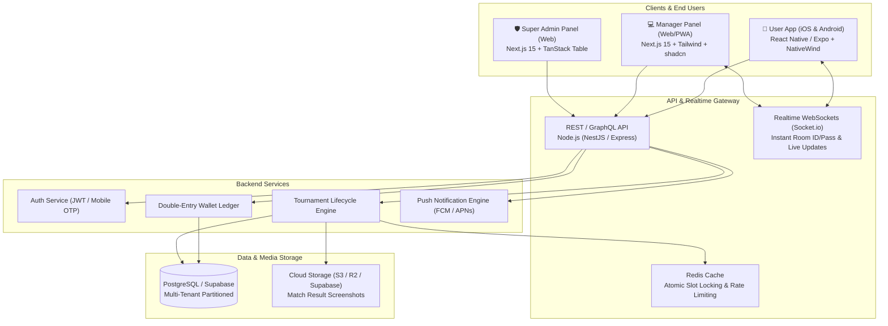

# 🎮 Free Fire Tournament Platform - Master Roadmap & Architecture Plan

> **Project Concept:** Multi-Tenant / White-Label Esports Tournament SaaS Platform (Exclusively for Free Fire & Free Fire MAX)  
> **Source Directives:** WhatsApp Requirements Discussion with Boss (`boss demand/WP.txt`)  
> **Author:** Jay Kumar  
> **Target Form Factor:** iOS-style Modern Mobile App (Player Panel) + Modern Responsive Web Dashboards (Admin & Manager Panels)  
> **Theme Support:** Native Dual Theme (Deep Dark Mode & Clean Light Mode)

---

## 📌 1. Executive Summary & Boss Requirements Breakdown

Boss ki chat (`WP.txt`) ke basis par key points aur business model:

| Boss Requirement | Technical Interpretation | Implementation Strategy |
| :--- | :--- | :--- |
| **"Multiple clients ko sell karna hai"** | **Multi-Tenant / White-Label SaaS Architecture** | Ek centralized backend jisme har client (Tournament Organizer) apna sub-brand, custom logo, payment gateway aur matches chala sake. Database level par `tenant_id` isolation. |
| **"Html se bas mat banana... React me pura app"** | **Modern Component-Driven Tech Stack** | Mobile App: **React Native (Expo SDK / Bare)** ya **Flutter** (iOS native feeling ke liye). Web Panels: **Next.js / React + Tailwind CSS + shadcn/ui**. |
| **"iOS / iPhone app ke jaisa modern UI"** | **Cupertino / Glassmorphic Design System** | Rounded cards (16px/24px radius), subtle blur/glassmorphism, smooth spring micro-animations, bottom sheets, floating navigation bar. |
| **"Light mode dark mode rakhna"** | **System & Manual Theme Switcher** | Tailored Dark Gaming Theme (OLED Black + Neon Violet/Orange accents) aur Clean Light Theme (Apple Slate Grey + Crisp White). |
| **"3 Panels: Admin, Manager, User"** | **Role-Based Access Control (RBAC)** | 1. **Super Admin Panel** (Platform Owner)<br>2. **Manager Panel** (Client/Organizer)<br>3. **User App** (Free Fire Gamers) |
| **"Feature advance banana, security me dekh lunga"** | **High-Tech Tournament Engine** | Anti-fraud slot booking, auto-wallet ledger, room credentials timed delivery, screenshot result upload, commission payout automation. |
| **"Banate time preview dikhate rehna"** | **CI/CD & Live Staging Links** | Expo Go / Web Preview deployments har phase ke end par boss ko live review karwane ke liye. |

---

## 🏗️ 2. High-Level Architecture & Tech Stack Recommendation



### Recommended Technology Stack:
1. **Mobile App (Player Panel)**:
   - **Framework:** **React Native with Expo** (TypeScript) + **NativeWind (Tailwind CSS for React Native)**.
   - **UI Polish:** `@gorhom/bottom-sheet`, `react-native-reanimated`, `expo-haptics`, `lucide-react-native`, `expo-blur`.
   - **Why?** Boss ne React approve kiya hai, aur Expo se directly iOS aur Android dono par 100% iPhone-style fluid UI banti hai bina alag-alag Swift/Kotlin likhe.

2. **Manager & Super Admin Dashboards (Web)**:
   - **Framework:** **Next.js 15 (App Router)** or **Vite + React**.
   - **UI Library:** **shadcn/ui** (Radix UI primitives) + **Tailwind CSS** + **Lucide Icons** + **Tremor Charts**.
   - **State & Tables:** `@tanstack/react-query` + `@tanstack/react-table`.

3. **Backend & Cloud Architecture: Smart Hybrid Model (Firebase + Supabase)**:
   - **The Smart Hybrid Approach (Recommended):**
     * **Firebase Auth & FCM:** Free Fire players ke fast Mobile Number + OTP Login ke liye Firebase Authentication, aur Match start hone se 15 min pehle Room ID/Password ka high-priority device notification bhejne ke liye **Firebase Cloud Messaging (FCM)**.
     * **Supabase (Managed PostgreSQL):** Core relational database, multi-tenant isolation, Prisma ORM connectivity, double-entry wallet ledger, aur screenshot image storage ke liye **Supabase Storage**.
     * **Realtime Layer:** Supabase Realtime / Socket.io for instant live slot updates and in-app room revealing.
     * **In-Memory Cache & Mutex:** **Redis (Upstash / Redis)** slot booking me high concurrency race condition prevent karne ke liye.
   - **Alternative (Pure Firebase):**
     * Agar boss strictly 100% Firebase chahte hain: **Cloud Firestore + Firebase Auth + Firebase Storage + Cloud Functions (Node.js)**. (Note: Firestore me slot booking ke waqt concurrency limit ka dhyan rakhna padega).

---

## 👥 3. Detailed Role-Based Panel Specifications

### 🛡️ Panel 1: Super Admin Panel (Platform Owner)
*Ye panel platform ke master owner (aap aur boss) ke liye hoga jisse multiple clients/tenants ko onboard aur control kiya jayega.*
- **Client/Tenant Management:** Naye tournament organizer (client) ko create karna, unka plan/license activate karna, unka custom domain ya tenant slug assign karna.
- **Global Financials & Commission:** 
  - Har client se platform ka kitna commission percentage katega (e.g., 5% - 10% platform fee).
  - Platform-wide revenue, active users, total matches hosted ka overview.
- **Global User & Fraud Monitoring:**
  - Cheaters, ban lists, multiple fake accounts detection (Device ID tracking).
- **Payment Gateway Configs:**
  - Client-wise gateway settings (Razorpay / Cashfree / PhonePe / Manual UPI QR).
- **Global App Configuration:**
  - Maintenance mode toggle, mandatory app update banner, notice board alerts.

---

### 💼 Panel 2: Manager Panel (Tournament Organizer / Client)
*Ye panel us organizer ko milega jo tournament host karega aur match organize karega.*
- **Organizer Dashboard:**
  - Today's Matches, Total Joined Players, Entry Fees Collected, Prize Money Pending, Net Profit.
- **Tournament Creator (Advanced Free Fire Config):**
  - **Game Mode:** Solo, Duo, Squad, Clash Squad (CS 4v4).
  - **Map Selection:** Bermuda, Purgatory, Kalahari, Alpine, NeXTerra.
  - **Scoring Type:** Survival/Rank Points + Per Kill Bounty (e.g. ₹10 per kill, 1st prize ₹500).
  - **Room Specs:** Gun Property (Yes/No), Character Skill (Yes/No), Limited Ammo (Yes/No), Loadout (Yes/No).
  - **Schedule:** Match Date, Match Time, Registration Close Time.
  - **Slots Capacity:** 48 players (Solo) / 24 teams (Duo) / 12 teams (Squad).
- **Room Management (Match Day Operations):**
  - Scheduled time se 10-15 minute pehle **Room ID** & **Password** enter karna (ye direct sirf registered players ko notify hoga).
  - Spectator links & streaming embed link (YouTube/Rooter/Loco).
- **Result & Screenshot Verification Workflow:**
  - Players dwara upload kiye gaye scorecard/kills screenshot review karna.
  - Kills aur rank fill karke "Publish Result" button dabana.
  - Automatic prize calculation aur player wallet me winning credit karna.
- **Dispute & Refund Desk:**
  - Agar match hacker ki wajah se cancel hua ya room issue hua, to 1-Click "Full Match Refund" feature.

---

### 🎮 Panel 3: User / Player Mobile App (iOS-Style Experience)
*Ye players ke hath me hoga jahan wo match join karenge aur game khelenge.*
- **Onboarding & Auth:**
  - Mobile Number + OTP Login, Google One-Tap.
  - Free Fire Profile Setup: **Free Fire In-Game Name (IGN)** & **Free Fire UID** (Mandatory verification).
- **Home & Match Explorer:**
  - Category Filters: *Daily Tournaments*, *High Stakes*, *Free Entry / Giveaways*, *Clash Squad 1v1 / 4v4*.
  - Match Card UI: Match Banner, Map Name, Prize Pool, Per Kill Reward, Entry Fee, Available Slots Progress Bar (e.g., 38/48 Joined).
- **Interactive Slot Selector:**
  - Solo ke liye direct entry; Squad ke liye Slot 1 se Slot 12 tak seat map (kaun sa squad slot khali hai dekh kar select karna).
  - Team Code generation to invite friends directly into the squad slot.
- **Match Room Locker (Security Feature):**
  - Match start hone se 15 min pehle countdown timer.
  - Jaise hi manager Room ID & Password dale, instant Push Notification + Copy Room ID & Password one-click button.
- **Wallet System:**
  - Balance Split: **Deposit Cash** | **Winnings Cash** | **Bonus Coins**.
  - Add Money via UPI (GPay, PhonePe, Paytm).
  - Instant Withdrawal request to UPI / Bank Account with status tracking (Pending -> Approved -> Success).
- **Result & Proof Submission:**
  - Match khatam hone ke baad end screen screenshot upload karne ka section (kill proof aur booyah proof).
- **Social & Gamification:**
  - Leaderboard (Top Earners, Top Fraggers of the Month).
  - Refer & Earn system (Referral code to earn bonus entry coins).
  - Dual Theme: OLED Dark Mode (Default gaming feel) / Cupertino Light Mode.

---

## 🗄️ 4. Multi-Tenant Database Schema Blueprint

```sql
-- 1. Tenants (Clients / Organizers)
CREATE TABLE tenants (
    id UUID PRIMARY KEY DEFAULT gen_random_uuid(),
    name VARCHAR(100) NOT NULL,
    slug VARCHAR(50) UNIQUE NOT NULL, -- e.g. "jharkhand-esports"
    logo_url TEXT,
    branding_colors JSONB, -- { "primary": "#FF5722", "darkBg": "#0A0A0C" }
    status VARCHAR(20) DEFAULT 'ACTIVE',
    commission_rate DECIMAL(5, 2) DEFAULT 10.00, -- Platform cut %
    created_at TIMESTAMP WITH TIME ZONE DEFAULT NOW()
);

-- 2. Users (Players across tenants)
CREATE TABLE users (
    id UUID PRIMARY KEY DEFAULT gen_random_uuid(),
    tenant_id UUID REFERENCES tenants(id) ON DELETE CASCADE,
    phone VARCHAR(20) NOT NULL,
    name VARCHAR(100),
    ff_ign VARCHAR(50) NOT NULL, -- Free Fire In-Game Name
    ff_uid VARCHAR(30) NOT NULL, -- Free Fire Numeric UID
    role VARCHAR(20) DEFAULT 'PLAYER', -- 'SUPERADMIN', 'MANAGER', 'PLAYER'
    wallet_deposit DECIMAL(10,2) DEFAULT 0.00,
    wallet_winnings DECIMAL(10,2) DEFAULT 0.00,
    wallet_bonus DECIMAL(10,2) DEFAULT 0.00,
    is_banned BOOLEAN DEFAULT FALSE,
    created_at TIMESTAMP WITH TIME ZONE DEFAULT NOW(),
    UNIQUE(tenant_id, phone),
    UNIQUE(tenant_id, ff_uid)
);

-- 3. Tournaments
CREATE TABLE tournaments (
    id UUID PRIMARY KEY DEFAULT gen_random_uuid(),
    tenant_id UUID REFERENCES tenants(id) ON DELETE CASCADE,
    created_by UUID REFERENCES users(id),
    title VARCHAR(150) NOT NULL,
    match_type VARCHAR(20) NOT NULL, -- 'SOLO', 'DUO', 'SQUAD', 'CS_4V4'
    map_type VARCHAR(50) NOT NULL, -- 'BERMUDA', 'PURGATORY', 'KALAHARI', 'ALPINE'
    entry_fee DECIMAL(10, 2) NOT NULL DEFAULT 0.00,
    prize_pool DECIMAL(10, 2) NOT NULL,
    per_kill_prize DECIMAL(10, 2) DEFAULT 0.00,
    total_slots INT NOT NULL DEFAULT 48,
    match_time TIMESTAMP WITH TIME ZONE NOT NULL,
    room_id VARCHAR(50),
    room_password VARCHAR(50),
    room_released_at TIMESTAMP WITH TIME ZONE,
    status VARCHAR(30) DEFAULT 'UPCOMING', -- 'UPCOMING', 'OPEN', 'ONGOING', 'VERIFYING', 'COMPLETED', 'CANCELLED'
    rules_notes TEXT,
    created_at TIMESTAMP WITH TIME ZONE DEFAULT NOW()
);

-- 4. Tournament Participants & Slot Booking
CREATE TABLE tournament_participants (
    id UUID PRIMARY KEY DEFAULT gen_random_uuid(),
    tournament_id UUID REFERENCES tournaments(id) ON DELETE CASCADE,
    user_id UUID REFERENCES users(id),
    slot_number INT NOT NULL, -- 1 to 48 or Team 1-12
    team_name VARCHAR(50),
    kills INT DEFAULT 0,
    rank INT DEFAULT 0,
    prize_won DECIMAL(10, 2) DEFAULT 0.00,
    screenshot_proof_url TEXT,
    is_verified BOOLEAN DEFAULT FALSE,
    created_at TIMESTAMP WITH TIME ZONE DEFAULT NOW(),
    UNIQUE(tournament_id, slot_number),
    UNIQUE(tournament_id, user_id)
);

-- 5. Wallet Ledger (Strict Double-Entry Records)
CREATE TABLE wallet_transactions (
    id UUID PRIMARY KEY DEFAULT gen_random_uuid(),
    tenant_id UUID REFERENCES tenants(id),
    user_id UUID REFERENCES users(id) ON DELETE CASCADE,
    tournament_id UUID REFERENCES tournaments(id),
    amount DECIMAL(10,2) NOT NULL,
    type VARCHAR(30) NOT NULL, -- 'DEPOSIT', 'ENTRY_FEE', 'WINNING_PAYOUT', 'WITHDRAWAL', 'REFUND', 'BONUS'
    status VARCHAR(20) DEFAULT 'SUCCESS', -- 'PENDING', 'SUCCESS', 'FAILED'
    reference_id VARCHAR(100), -- Gateway Transaction ID / UTR
    notes TEXT,
    created_at TIMESTAMP WITH TIME ZONE DEFAULT NOW()
);
```

---

## 🗓️ 5. Step-by-Step Implementation Phases (7-Phase Roadmap)

### 📍 Phase 1: Foundation & Multi-Tenant Database Setup (Days 1–3)
- [ ] Initialize monorepo or standard folder structure (`/mobile-app`, `/admin-web`, `/backend-api`).
- [ ] Set up PostgreSQL database with Multi-Tenant schema (Tenants, Users, Tournaments, Slots, Ledger).
- [ ] Docker container setup for local DB + Redis.
- [ ] Seed script ready with demo tenant (e.g., "Apex Free Fire Club") and demo tournaments.

### 📍 Phase 2: Authentication & Core API Service (Days 4–7)
- [ ] Multi-tenant Auth service (JWT tokens with `tenant_id` and `role` claims).
- [ ] Phone OTP login flow + Free Fire UID & In-game name capture.
- [ ] Role Guards: SuperAdmin, Manager, and Player middleware.
- [ ] Swagger / Postman API documentation auto-generation for testing.

### 📍 Phase 3: Tournament Engine & Race-Condition Proof Slot Booking (Days 8–12)
- [ ] Match creation endpoints with Free Fire presets (Bermuda/Purgatory, Solo/Duo/Squad, Gun Prop off, etc.).
- [ ] **Atomic Slot Reservation with Redis:** Prevent two players from booking the same slot at the exact same millisecond.
- [ ] Squad invitation flow (leader generates 6-digit squad join code for teammates).
- [ ] Automatic entry fee deduction from User Wallet.

### 📍 Phase 4: Room ID Delivery & Match Day Automation (Days 13–16)
- [ ] Manager Room ID & Password input UI with scheduled trigger.
- [ ] WebSocket / Socket.io channel: Room credentials broadcast strictly to confirmed tournament participants.
- [ ] Push Notifications via Firebase Cloud Messaging (FCM).
- [ ] Match status state machine (`UPCOMING` -> `ROOM_OPEN` -> `LIVE` -> `VERIFICATION` -> `COMPLETED`).

### 📍 Phase 5: Result Processing, Screenshot Verification & Wallet Ledger (Days 17–21)
- [ ] Player Screenshot upload pipeline to Cloud Storage.
- [ ] Manager Review Dashboard: Side-by-side screenshot viewer with Kill count and Rank input.
- [ ] 1-Click Winner Payout Calculator (calculates rank reward + per-kill bonus automatically).
- [ ] 1-Click Match Cancellation & Auto-Refund to all participant wallets if room crashes.
- [ ] Withdrawal request management (Approve/Reject with UTR reference).

### 📍 Phase 6: iOS-Style UI/UX & Native Polish (Days 22–27)
- [ ] Native Cupertino components integration:
  - Frosted glass blur headers (`expo-blur`).
  - Smooth bottom sheets (`@gorhom/bottom-sheet`) for match details and slot pickers.
  - Haptic feedback on button clicks (`expo-haptics`).
- [ ] Complete **Dark & Light Mode** styling tokens with smooth transitions.
- [ ] Clean card layouts, tournament countdown timers, and live slot counter bars.
- [ ] Deploy web preview & Expo build for Boss review.

### 📍 Phase 7: Multi-Client White-Label Engine & Security Hardening (Days 28–30)
- [ ] Dynamic branding injector: Logo, primary colors, and app name load dynamically based on Tenant configuration.
- [ ] Security hardening:
  - Device ID fingerprinting to block multiple accounts per device.
  - Rate limiting on sensitive wallet and slot-booking endpoints.
  - SQL injection & XSS sanitization.
- [ ] Final end-to-end testing (Solo, Duo, Squad tournament lifecycle from creation to cash withdrawal).

---

## 🔗 6. Top GitHub Repositories & UI Kits to Reference

Aapke research aur code references ke liye best open-source GitHub projects:

### 🎮 Tournament & Esports Platforms (Logic & Architecture References)
1. **[AnupSharma12 / syndicate](https://github.com/AnupSharma12/syndicate)**
   - *Stack:* Next.js, React, TypeScript, Tailwind CSS, Firebase
   * *Utility:* Esports tournament management platform for Free Fire, Valorant, etc. Team/squad handling aur admin flow ka clean reference.
2. **[codeAntu / battle-zone](https://github.com/codeAntu/battle-zone)**
   - *Stack:* TypeScript, React, Tailwind CSS, Node.js
   * *Utility:* BGMI & Free Fire tournament registration, wallet entry fee handling, and OTP verification flow.
3. **[tomasmajercik / tournify](https://github.com/tomasmajercik/tournify)**
   - *Stack:* React Native (Expo), Express.js, PostgreSQL
   * *Utility:* Complete mobile app for organizing and joining tournaments with brackets, participant management, and real-time updates.
4. **[ahmadbenos / mobile-tournament-manager-app](https://github.com/ahmadbenos/mobile-tournament-manager-app)**
   - *Stack:* React Native, AWS Lambda, MongoDB
   * *Utility:* League and tournament scheduling with mobile UI state management.

### 📱 iOS-Style UI & Modern Component Kits (React Native / Expo)
1. **[nativewind / nativewind](https://github.com/nativewind/nativewind)**: Tailwind CSS v4 inside React Native for effortless dark/light styling.
2. **[gorhom / react-native-bottom-sheet](https://github.com/gorhom/react-native-bottom-sheet)**: Exact iOS Apple Maps style smooth interactive bottom sheets.
3. **[software-mansion / react-native-reanimated](https://github.com/software-mansion/react-native-reanimated)**: 60fps / 120fps fluid physics-based animations.
4. **[shadcn / ui](https://github.com/shadcn-ui/ui)**: For Admin & Manager Web Dashboard - industry standard clean modern UI.
5. **[tremorlabs / tremor](https://github.com/tremorlabs/tremor)**: Beautiful modern charts and metrics for Super Admin & Organizer analytics.

---

## 🎯 7. The Ultimate "Deep Research & GitHub Hunting" Master Prompt

*Aap is prompt ko Gemini, Claude, ya Perplexity me copy-paste karke ultra-deep research kar sakte hain:*

```text
You are a Principal Software Architect and Lead Mobile Engineer specializing in real-money esports platforms (similar to Gamerji, Khiladi Adda, WinZO, and Battlemania) tailored for Garena Free Fire tournaments.

I am developing a multi-tenant, white-label Free Fire Tournament SaaS platform that will be sold to multiple tournament organizers (clients). The system consists of:
1. Mobile App (Players/Users): Built with React Native (Expo) or Flutter, strictly following modern iOS design principles (Cupertino glassmorphic blur, smooth bottom sheets, haptic feedback, dual OLED Dark & Light modes).
2. Manager Panel (Organizers): Web-based portal to create custom Free Fire matches (Solo/Duo/Squad/Clash Squad, maps like Bermuda/Purgatory/Alpine), input timed Room IDs & Passwords, verify player screenshot proofs, and distribute prize pools.
3. Super Admin Panel: Multi-tenant control center to manage client licenses, global platform commission cuts, payment gateway configs, and anti-fraud/ban lists.

Conduct a deep research dive and provide:
1. GITHUB REPOSITORIES & BOILERPLATES:
   - Identify active open-source GitHub repositories for esports tournament apps, tournament brackets, and wallet/ledger systems. Provide exact repo paths, tech stacks, and what architectural modules can be borrowed.
2. CONCURRENCY & SLOT LOCKING ALGORITHM:
   - Provide a battle-tested Redis Mutex / Distributed Lock implementation in Node.js/TypeScript to prevent race conditions when 100+ players attempt to join the remaining 2 slots of a tournament simultaneously.
3. FREE FIRE TOURNAMENT WORKFLOW & AUTOMATION:
   - How to architect the timed delivery of Custom Room ID and Password so that only registered, verified players can view it exactly 15 minutes before match start.
   - Design an OCR or streamlined verification pipeline for end-game match screenshots (Kill count and Booyah rank) to speed up manual manager review.
4. MULTI-TENANT DATABASE DESIGN:
   - Provide a complete PostgreSQL DDL schema with Row Level Security (RLS) or tenant_id partitioning ensuring complete data isolation between different tournament organizers.
5. UI/UX DESIGN TOKENS & COMPONENT ARCHITECTURE:
   - Provide a design system spec for React Native (NativeWind / Tailwind) that mimics high-end iOS gaming aesthetics (blur backdrops, card elevations, animated slot progress bars, and high-contrast dark/light mode palettes).
```

---

## 🚀 8. Immediate Next Steps for Jay

1. **Boss ko Preview bhejo:** `plan/ROADMAP.md` ka summary boss ke sath share karo taaki unhe confidence ho jaye ki architecture multi-tenant, modern iOS UI aur full security ke hisab se planned hai.
2. **Backend Development Kickoff (Phase 1):** Backend folder initialize karke database schema aur API router structure taiyar karein.

---

## 🛠️ 9. Backend Development Starting Blueprint (Kidhar se shuru karein)

Aap backend developer hain, toh backend development ko in **5 specific steps** me shuru kiya jayega:

### Step 1: Project Folder & Environment Scaffolding
- Root directory me `backend/` folder create karna.
- Node.js + TypeScript environment initialize karna:
  ```bash
  npm init -y
  npm install express dotenv cors helmet ioredis @prisma/client
  npm install -D typescript tsx @types/node @types/express prisma
  npx tsc --init
  ```

### Step 2: Supabase Project & Prisma Schema Connection
- [supabase.com](https://supabase.com) par free project banana.
- Supabase se PostgreSQL connection string copy karke `.env` me daalna:
  `DATABASE_URL="postgresql://postgres:[PASSWORD]@[HOST]:5432/postgres"`
- `npx prisma init` run karke hamara Multi-Tenant schema (`Tenants`, `Users`, `Tournaments`, `TournamentSlots`, `WalletLedger`) `prisma/schema.prisma` me paste karna.
- `npx prisma db push` chalakar Supabase me tables ready karna.

### Step 3: Firebase Admin SDK Integration (Auth & FCM)
- Firebase console se service account JSON download karna (`firebase-admin` setup).
- Auth middleware banana jo player ke phone OTP token ko verify karega aur user create/login karega.

### Step 4: Core Tournament & Slot Booking Engine (The Meat)
- Free Fire tournament creation CRUD endpoints (Manager ke liye).
- **Atomic Slot Reservation Logic (Redis Mutex / Redlock):**
  - Player join API with atomic check: `POST /api/tournaments/:id/join`
  - Balance check -> Slot lock -> Entry fee deduction -> Confirmed slot ticket.

### Step 5: Timed Room ID & Result Submission Workflow
- Room Credentials release API with 15-minute countdown lock:
  `GET /api/tournaments/:id/room-credentials`
- Match result & screenshot upload endpoint linking to Supabase Storage.

