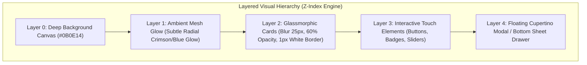

# 🎨 Free Fire Tournament Platform - UI/UX Deep Research & Design System Blueprint (Hinglish)

> **Document Type:** Comprehensive UI/UX Engineering & Design Architecture Guide  
> **Target Project:** Multi-Tenant / White-Label Free Fire & Free Fire MAX Tournament Platform  
> **Source Directives:** Boss WhatsApp Discussion (`boss demand/WP.txt` - *"iOS / iPhone app ke jaisa modern UI rakhna, Light mode dark mode rakhna, UI pe detail me kaam karna"*)  
> **Lead Developer:** Jay Kumar  
> **Design Philosophy:** Apple Human Interface Guidelines (HIG) + CRED-Grade Micro-Interactions + Esports Cyberpunk Firepower

---

## 📋 Table of Contents (Index)

1. [UI/UX Executive Philosophy & Boss Directives Analysis](#1-uiux-executive-philosophy--boss-directives-analysis)
2. [Market UI/UX Teardown (WinZO vs Khiladi Adda vs Apple Standards)](#2-market-uiux-teardown-winzo-vs-khiladi-adda-vs-apple-standards)
3. [Dual Theme Design Tokens: OLED Deep Dark & Apple Crisp Light](#3-dual-theme-design-tokens-oled-deep-dark--apple-crisp-light)
4. [Typography, Hierarchy, Spacing & Corner Radius Rules](#4-typography-hierarchy-spacing--corner-radius-rules)
5. [Glassmorphism, Elevation & Frosted Blur Architecture](#5-glassmorphism-elevation--frosted-blur-architecture)
6. [Micro-Interactions, Gestures & Haptic Feedback Engine](#6-micro-interactions-gestures--haptic-feedback-engine)
7. [Screen-by-Screen Deep UX Wireframe & Interaction Flows](#7-screen-by-screen-deep-ux-wireframe--interaction-flows)
   - 7.1 [Splash Screen & 1-Tap Onboarding (FF UID Linking)](#71-splash-screen--1-tap-onboarding-ff-uid-linking)
   - 7.2 [Home & Tournament Discovery Hub](#72-home--tournament-discovery-hub)
   - 7.3 [Tournament Details & Interactive Slot Grid (Solo, Duo, Squad)](#73-tournament-details--interactive-slot-grid-solo-duo-squad)
   - 7.4 [Locked vs Unlocked Room ID & Password Modal (15-Min Reveal)](#74-locked-vs-unlocked-room-id--password-modal-15-min-reveal)
   - 7.5 [Slide-to-Confirm Action Button (Accidental Tap Prevention)](#75-slide-to-confirm-action-button-accidental-tap-prevention)
   - 7.6 [Double-Entry Wallet & Seamless UPI Deposit/Withdrawal UX](#76-double-entry-wallet--seamless-upi-depositwithdrawal-ux)
   - 7.7 [Result Submission & WhatsApp-Style Image Cropper UX](#77-result-submission--whatsapp-style-image-cropper-ux)
   - 7.8 [Leaderboard, Player Profile & Stats Showcase](#78-leaderboard-player-profile--stats-showcase)
8. [Manager & Admin Web Dashboard UX (Desktop/PWA Ergonomics)](#8-manager--admin-web-dashboard-ux-desktoppwa-ergonomics)
9. [Multi-Tenant White-Label Theming Engine (Zero Layout Breakage)](#9-multi-tenant-white-label-theming-engine-zero-layout-breakage)
10. [Production Ready UI Implementation Code (Jetpack Compose & React Native)](#10-production-ready-ui-implementation-code-jetpack-compose--react-native)
11. [Crucial UI/UX Anti-Patterns (Galtiyan Jo Kabhi Nahi Karni)](#11-crucial-uiux-anti-patterns-galtiyan-jo-kabhi-nahi-karni)

---

## 1. UI/UX Executive Philosophy & Boss Directives Analysis

Boss ne WhatsApp chat me clear instructions di hain:
> **"Iso . iPhone app ke jaisa modern ui rakhna"**  
> **"Light mode dark mode rakhna"**  
> **"Multiple client ko sell karna hai... UI pe detail me kaam karna"**  
> **"Jay: Mera UI/UX me issue hota hai... Boss: Fichar pe kaam karo, UI me dekh lunga"**

Jay, agar aapka UI/UX weak bhi hai, toh fikar karne ki zaroorat nahi hai. UI koi magic nahi hota, **math aur structure ka set of rules** hota hai. Jab aap strict design rules aur pre-defined tokens follow karte hain, toh app automatic **Apple Grade** ban jati hai.

### 🎯 Apple iOS Design Philosophy vs Typical Indian Gaming Apps

| Traditional Indian Tournament Apps (Khiladi Adda, Battlemania) | Humara New Apple-Grade Free Fire Platform |
| :--- | :--- |
| **Boring Gradients:** Chanchal neon colors, yellow-red gradient jo aankhon me chubhti hai. | **Subtle Depth:** Frosted glassmorphism, 1px white border (`border-white/10`), OLED dark surface. |
| **Crowded & Crammed:** Ek hi screen par 50 banners, scrolling text tickers, popup alerts. | **Negative Space & Breathing Room:** Generous 16px/20px margins, content cards with focal hierarchy. |
| **Square Sharp Edges:** Purane 4px radius wale Android boxes. | **Cupertino Squircle Radius:** 20px-28px continuous curvature (Smooth corners). |
| **Static Clicks:** Button dabane par achanak page load hota hai (No feedback). | **Fluid Spring Physics & Haptics:** Button dabane par gentle scale down (0.96x), tactile haptic feedback. |
| **Inconsistent Modes:** Sirf dark mode ya fir ajeeb sa light mode jisme text gayab ho jata hai. | **Perfect Dual Theme:** Deep OLED Black (`#0B0E14`) & Crisp Slate White (`#F8F9FA`). |

---

## 2. Market UI/UX Teardown (WinZO vs Khiladi Adda vs Apple Standards)

Indian market ke top apps ka UI teardown karke humne unke best points liye hain aur unki galtiyon ko khatam kiya hai:

```
┌─────────────────────────────────────────────────────────────────────────────┐
│                           COMPETITOR UI/UX AUDIT                            │
├──────────────┬──────────────────────────────┬───────────────────────────────┤
│ App / Brand  │ UI/UX Strengths (Achhi Baat) │ Critical UX Flaws (Badi Kami) │
├──────────────┼──────────────────────────────┼───────────────────────────────┤
│ WinZO        │ • Instant visual feedback    │ • Gamified clutter bahut zyada│
│              │ • Fast deposit micro-funnel  │ • Dedicated tournament room   │
│              │ • High color contrast        │   ke liye custom feel nahi hai│
├──────────────┼──────────────────────────────┼───────────────────────────────┤
│ Khiladi Adda │ • Simple match cards         │ • Purana Android 4.4 Holo look│
│              │ • Clear entry fee badge      │ • No haptic feedback          │
│              │                              │ • Light mode totally missing  │
├──────────────┼──────────────────────────────┼───────────────────────────────┤
│ CRED / Apple │ • Unbeatable glassmorphic UI │ • Esports games ke liye heavy │
│ Design System│ • Fluid 60/120fps spring phy │   customization ki zaroorat   │
│              │ • Haptic tactile sensations  │   hoti hai                    │
├──────────────┼──────────────────────────────┼───────────────────────────────┤
│ ✨ OUR APP   │ • Apple HIG + CRED Physics   │ • Solves all gaps: Fast slots,│
│ (Target UX)  │ • Dual OLED/Light Theme      │   15-min Room ID reveal,      │
│              │ • 1-Tap Free Fire Copy Paste │   Slide-to-Join, Zero Clutter │
└──────────────┴──────────────────────────────┴───────────────────────────────┘
```

---

## 3. Dual Theme Design Tokens: OLED Deep Dark & Apple Crisp Light

App me **Light Mode aur Dark Mode dono perfect look** me render hone chahiye. Kabhi bhi pure black (`#000000`) me flat surface nahi banayi jati, balki layered elevation use ki jati hai.

### 🎨 Color Palette Reference Table

```
═══════════════════════════════════════════════════════════════════════════════
                      DUAL THEME DESIGN TOKENS MATRIX
═══════════════════════════════════════════════════════════════════════════════
 Token Role             Dark Theme (OLED Night)      Light Theme (Apple Day)
───────────────────────────────────────────────────────────────────────────────
 Background Base        #0B0E14 (Deep Void Navy)    #F8F9FA (Crisp Studio Grey)
 Surface / Card Level 1 #151922 (Elevated Slate)    #FFFFFF (Pure Apple White)
 Surface / Card Level 2 #1E2433 (Interactive Hover) #EDF2F7 (Soft Slate Cloud)
 Border & Dividers      rgba(255, 255, 255, 0.08)   rgba(15, 23, 42, 0.08)
 Primary Text           #FFFFFF (100% Pure White)   #0F172A (Deep Slate 900)
 Secondary / Subtitle   #94A3B8 (Cool Slate Gray)   #64748B (Muted Navy Slate)
 Brand Accent (Primary) #FF4655 (Free Fire Crimson) #E11D48 (Vibrant Rose Red)
 Secondary Accent       #3B82F6 (Electric Sky Blue) #2563EB (Cupertino Blue)
 Win / Success (Booyah) #10B981 (Neon Emerald Green)#059669 (Vivid Forest Green)
 Warning / Timer Alert  #F59E0B (Cyber Amber Gold)  #D97706 (Deep Amber Orange)
 Danger / Error         #EF4444 (Laser Red)         #DC2626 (Vivid Crimson)
 Glass Tint Overlay     rgba(21, 25, 34, 0.70)      rgba(255, 255, 255, 0.75)
═══════════════════════════════════════════════════════════════════════════════
```

### 💻 Multi-Tenant Accent Palettes (Clients Ke Liye Custom Themes)

Jab aap alag-alag clients ko ye platform sell karenge, toh har client ka alag favorite color ho sakta hai. Humare system me sirf **1 Primary Token** change hoga aur puri app adapt kar legi:

* **Client A (Alpha Wolf):** Cyberpunk Red (`#FF4655`) + Dark Slate
* **Client B (Thunder Gaming):** Electric Cyan Blue (`#00D2D3`) + Deep Black
* **Client C (Godlike Clan):** Royal Gold (`#FFD700`) + Obsidian Black
* **Client D (Hydra eSports):** Toxic Emerald (`#10B981`) + Midnight Blue

---

## 4. Typography, Hierarchy, Spacing & Corner Radius Rules

UI ganda lagne ki 90% wajah **galat font sizes aur inconsistent spacing** hoti hai. Is rulebook ko religiously follow karein:

### 🔤 4.1 Typography Stack
* **iOS / Web:** `SF Pro Display` / `Inter` / `Plus Jakarta Sans`
* **Android (Jetpack Compose):** `Roboto Flex` ya custom `Plus Jakarta Sans`
* **Gaming Headings (Match Titles, Prize Amounts):** `Chakra Petch` ya `Rajdhani` (Esports Feel)

```
┌─────────────────────────────────────────────────────────────────────────────┐
│                            TYPOGRAPHY HIERARCHY                             │
├───────────────────┬──────────┬──────────┬─────────────┬─────────────────────┤
│ Style Name        │ Size     │ Weight   │ Line Height │ Best Use Case       │
├───────────────────┼──────────┼──────────┼─────────────┼─────────────────────┤
│ Display Huge      │ 32px     │ Bold/800 │ 38px        │ Wallet Total Balance│
│ Header Large (H1) │ 24px     │ Bold/700 │ 30px        │ Tournament Title    │
│ Header Medium (H2)│ 18px     │ Semi/600 │ 24px        │ Section Headers     │
│ Body Regular      │ 14px     │ Norm/400 │ 20px        │ Match Info, Rules   │
│ Body Bold / Badge │ 13px     │ Bold/700 │ 16px        │ Entry Fee, Map Name │
│ Caption / Micro   │ 11px     │ Med/500  │ 14px        │ Slot Number, Date   │
└───────────────────┴──────────┴──────────┴─────────────┴─────────────────────┘
```

### 📐 4.2 Spacing & Padding Rules (The 8pt Grid System)
Kabhi bhi random numbers (jaise 7px, 13px, 19px) use mat karein. Hamesha **4 ya 8 ke multiples** use karein:
* **Micro Spacing (4px / 8px):** Badges ke andar ka padding, icon aur text ke beech ka gap.
* **Component Padding (12px / 16px):** Tournament cards ke andar ka padding, list item gaps.
* **Screen Edge Margin (16px / 20px):** Phone screen ke left aur right se gap (iPhone safety area).
* **Section Gap (24px / 32px):** Do alag sections ke beech ka space (jaise "Live Matches" aur "Upcoming Matches").

### 🔲 4.3 Corner Radius (Cupertino Continuous Squircle)
* **Badges & Chips:** `100px` (Pill shape, e.g. `Bermuda Map`, `Solo/Duo`)
* **Buttons:** `14px` - `16px` (Touch friendly, rounded rectangle)
* **Tournament & Feature Cards:** `20px` - `24px` (Apple Card Signature Curve)
* **Bottom Sheet Modals:** `28px` (Top-left aur Top-right corners)

---

## 5. Glassmorphism, Elevation & Frosted Blur Architecture

Apple iOS ki sabse premium pehchan uska **frosted glass blur** hai. Isse app flat lagne ke bajaye deeply layered lagti hai.



### 🧪 Frosted Glass Formula (CSS & Jetpack Compose):
1. **Background Color:** `rgba(21, 25, 34, 0.65)` (Dark mode) / `rgba(255, 255, 255, 0.70)` (Light mode).
2. **Backdrop Filter (Blur):** `blur(20px)` to `blur(30px)`.
3. **Subtle Light Reflection Border:** `1px solid rgba(255, 255, 255, 0.10)` (Ye 1px border card ko background se alag karta hai aur luxury look deta hai).
4. **Soft Drop Shadow:** `box-shadow: 0 10px 30px -10px rgba(0, 0, 0, 0.5)`.

> 💡 **Native Android Tip:** Android me native blur ke liye hamare repo me maujood **`Cloudy`** engine (`Modifier.cloudy(radius = 25)`) use kiya jayega, jo low-end phones par bhi 60 FPS bina frame drop render karta hai!

---

## 6. Micro-Interactions, Gestures & Haptic Feedback Engine

Esports gamers fast hote hain. Agar app me button press par instant response na mile, toh unhe lagta hai app freeze ho gayi hai.

### ⚡ 6.1 Touch Feedback Physics (The 0.96x Bounce)
Har clickable card aur button par touch karne par **Spring Animation** honi chahiye:
* **On Touch Down:** Scale down `0.96x` with duration 100ms.
* **On Touch Release:** Spring bounce back to `1.00x` with damping ratio `0.7`.
* **Visual Result:** User ko feel hota hai ki physical mechanical button press ho raha hai.

### 📳 6.2 Tactile Haptic Vibration Map (User Actions)

```
┌─────────────────────────────────────────────────────────────────────────────┐
│                       HAPTIC FEEDBACK SENSORY SYSTEM                        │
├──────────────────────┬──────────────────────┬───────────────────────────────┤
│ User Event           │ Haptic Pattern Type  │ Emotional Feeling             │
├──────────────────────┼──────────────────────┼───────────────────────────────┤
│ Slot Select in Grid  │ Light Impact (5ms)   │ Subtle "click" feel           │
│ 1-Tap Copy Room ID   │ Medium Impact (12ms) │ Confirmed satisfaction        │
│ Slide-to-Join Lock   │ Heavy Spring Thud    │ "Slot Secured!" achievement   │
│ Payment Booyah Cash  │ Success Double Pulse │ Rewarding winning vibe        │
│ Slot Already Booked  │ Error Triple Pulse   │ Warning alert                 │
│ Pull to Refresh      │ Rigid Tick on snap   │ Crisp tactile feedback        │
└──────────────────────┴──────────────────────┴───────────────────────────────┘
```

---

## 7. Screen-by-Screen Deep UX Wireframe & Interaction Flows

### 7.1 Splash Screen & 1-Tap Onboarding (FF UID Linking)

Gamers lambe registration forms se nafrat karte hain. Agar aapne unse password, address, aur OTP maanga, toh 60% players app uninstall kar denge.

```
┌─────────────────────────────────────────────────────────┐
│                      SPLASH & ONBOARDING                │
├─────────────────────────────────────────────────────────┤
│                                                         │
│                     [ 🎮 LOGO ]                         │
│                  FREE FIRE ARENA                        │
│             "Compete. Booyah. Earn."                    │
│                                                         │
│                                                         │
│        ┌───────────────────────────────────────┐        │
│        │   [G] Continue with Google (1-Tap)   │        │
│        └───────────────────────────────────────┘        │
│                                                         │
│        ─── Quick Free Fire Verification ───             │
│                                                         │
│        ┌───────────────────────────────────────┐        │
│        │ Enter Free Fire UID (e.g. 192847192)  │        │
│        └───────────────────────────────────────┘        │
│        ┌───────────────────────────────────────┐        │
│        │ Enter In-Game Name (IGN)              │        │
│        └───────────────────────────────────────┘        │
│                                                         │
│        ┌───────────────────────────────────────┐        │
│        │         ENTER BATTLEGROUND  ➔         │        │
│        └───────────────────────────────────────┘        │
│                                                         │
└─────────────────────────────────────────────────────────┘
```

#### 🔑 Onboarding UX Rules:
1. **Google 1-Tap Credential Manager:** Email aur photo automatically fetch ho jati hai, password yaad rakhne ki zaroorat nahi.
2. **Immediate UID Prompt:** User se usi waqt uska Free Fire UID aur IGN (In-Game Name) manga jaye, taaki baad me match join karte waqt koi delay na ho.
3. **UID Helper Tooltip:** "UID Kaha Milegi?" par tap karne par 3-second ka visual guide dikhana ki Free Fire profile me UID kahan likhi hoti hai.

---

### 7.2 Home & Tournament Discovery Hub

Ye app ki main screen hai. Yahan player ko 3 cheezein turant dikhni chahiye: **Uska Wallet Balance**, **Next Upcoming Match**, aur **Filter Tags**.

```
┌─────────────────────────────────────────────────────────┐
│  👤 Jay Kumar (LVL 42)          🪙 ₹240 [+]  🔔 [2]     │
├─────────────────────────────────────────────────────────┤
│                                                         │
│  🔥 FEATURED MEGA TOURNAMENT (Banner Carousel)          │
│  ┌───────────────────────────────────────────────────┐  │
│  │ 🏆 SUNDAY BOOYAH CUP #104                         │  │
│  │ Prize Pool: ₹10,000 | Entry: ₹50 | Map: Bermuda    │  │
│  │ [ Join Now - 4 slots left ]                       │  │
│  └───────────────────────────────────────────────────┘  │
│                                                         │
│  MATCH CATEGORIES (Pill Tabs):                          │
│  (• All)  ( Solo )  ( Duo )  ( Squad )  ( CS 4v4 )      │
│                                                         │
│  ─── UPCOMING MATCHES ────────────────────────────────  │
│                                                         │
│  ┌───────────────────────────────────────────────────┐  │
│  │ ⚡ BERMUDA CLASH SQUAD #402              [🔴 LIVE]│  │
│  │ Match Time: Today, 08:30 PM                        │  │
│  │ ───────────────────────────────────────────────── │  │
│  │ 💰 Pool: ₹1,200 | 🎯 Per Kill: ₹20 | Entry: ₹30   │  │
│  │ ───────────────────────────────────────────────── │  │
│  │ 👥 Slots: 42/48 Joined             [===-------]   │  │
│  │                                                   │  │
│  │ [ 📋 Details ]                 [ 🚀 JOIN ₹30 ]    │  │
│  └───────────────────────────────────────────────────┘  │
│                                                         │
│  [ 🏠 Home ]   [ 🎮 Matches ]   [ 💰 Wallet ]   [ ⚙️ ]  │
└─────────────────────────────────────────────────────────┘
```

#### 💡 Card UX Micro-Details:
* **Progress Bar with Color Shifts:** 
  * 0 - 30 slots: Cool Blue (`#3B82F6`)
  * 31 - 44 slots: Warning Gold (`#F59E0B`)
  * 45 - 48 slots: Fast Pulsing Red (`#EF4444` - "Hurry! Sirf 3 slots bache hain!")
* **Live Status Tag:** Agar match live hai toh red pulsing dot dikhana taaki user spectate ya score dekh sake.

---

### 7.3 Tournament Details & Interactive Slot Grid (Solo, Duo, Squad)

Jab user match card par tap karta hai, toh ek Cupertino Bottom Sheet ya dedicated screen open hoti hai jisme **Free Fire Custom Room ka visual slot grid** hota hai:

```
┌─────────────────────────────────────────────────────────┐
│  ← Match #402: Bermuda Battle Royale          Share ↗   │
├─────────────────────────────────────────────────────────┤
│  PRIZE BREAKDOWN:                                       │
│  🥇 1st Rank (Booyah): ₹500  | 🥈 2nd: ₹250 | 🎯 Kill: ₹25
├─────────────────────────────────────────────────────────┤
│  CHOOSE YOUR ROOM SLOT (Total: 48 Slots):                │
│                                                         │
│  [01: RahulFF]  [02: Toxic_OP]  [03: EMPTY ]  [04: EMPTY ]│
│  [05: Killer ]  [06: EMPTY   ]  [07: LOCKED]  [08: EMPTY ]│
│  [09: EMPTY  ]  [10: EMPTY   ]  [11: God_Jay]  [12: EMPTY ]│
│  ...                                                    │
│  [ Legend: 🟩 Available | 🟥 Taken | 🟦 Your Choice ]   │
│                                                         │
│  SELECTED: Slot #03 (Solo)                              │
│  WALLET DEDUCTION: ₹30                                  │
│                                                         │
│  ┌───────────────────────────────────────────────────┐  │
│  │  >>> SLIDE TO CONFIRM & PAY ₹30 >>>               │  │
│  └───────────────────────────────────────────────────┘  │
└─────────────────────────────────────────────────────────┘
```

#### 🛡️ Slot Grid Anti-Clash UX:
1. **Real-time Color State:**
   * Available: Dark translucent card with subtle green border.
   * Taken: Grayed-out with player's masked name (e.g. `Jay***`).
   * Currently Being Booked (Locked in Redis): Amber border with lock icon.
2. **Auto Slot Suggestion:** Agar player confuse ho, toh niche ek button ho: **"⚡ Pick Best Empty Slot"**, jo pehla available slot auto-select kar deta hai.

---

### 7.4 Locked vs Unlocked Room ID & Password Modal (15-Min Reveal)

Match shuru hone se 15 minute pehle sabse bada traffic spike aata hai. Us waqt ka UX crystal clear hona chahiye:

```
┌─────────────────────────────────────────────────────────┐
│                    ROOM CREDENTIALS                     │
├─────────────────────────────────────────────────────────┤
│                                                         │
│  [ STATE 1: MATCH SE PEHLE (LOCKED) ]                   │
│                                                         │
│  🔒 Room ID & Password is Locked                        │
│  Match Start Time: 08:30 PM                             │
│  Credentials will unlock in:                            │
│                                                         │
│               ┌──────────────────────┐                  │
│               │   14 MIN : 22 SEC    │                  │
│               └──────────────────────┘                  │
│  (Push notification aate hi yahan details dikhengi)     │
│                                                         │
├─────────────────────────────────────────────────────────┤
│                                                         │
│  [ STATE 2: 15 MIN PEHLE (UNLOCKED!) ]                  │
│                                                         │
│  🔓 CUSTOM ROOM DETAILS READY!                          │
│                                                         │
│  ROOM ID:     9 4 8 2 7 1 0                             │
│  [ 📋 Tap to Copy Room ID ]  (Haptic Vibrate)           │
│                                                         │
│  PASSWORD:    7 7 4 9                                   │
│  [ 📋 Tap to Copy Password ] (Haptic Vibrate)           │
│                                                         │
│  YOUR ALLOTTED SLOT:  SLOT #03                          │
│  ⚠️ Rule: Agar kisi aur slot me baithe toh kick out!    │
│                                                         │
│  ┌───────────────────────────────────────────────────┐  │
│  │   🚀 OPEN FREE FIRE APP DIRECTLY                  │  │
│  └───────────────────────────────────────────────────┘  │
│                                                         │
└─────────────────────────────────────────────────────────┘
```

#### 💎 Killer Feature (Deep Link UX):
* Niche ka button dabate hi Android Intent / iOS URL Scheme se seedha **Free Fire app open ho jati hai** (`com.dts.freefireth`), taaki user ko manual app search na karni pade!
* Copy button dabate hi toast message aata hai: **"Copied! Room ID clipboard me save ho gaya."**

---

### 7.5 Slide-to-Confirm Action Button (Accidental Tap Prevention)

Tournament join karte waqt ya cashout karte waqt regular "Confirm" button dene se players se **galti se click ho jata hai**, jisse dispute khada hota hai.

```
┌─────────────────────────────────────────────────────────┐
│             SLIDE-TO-CONFIRM MICRO-COMPONENT            │
├─────────────────────────────────────────────────────────┤
│                                                         │
│   [ ⚪ Drag Thumb ] ───────── Slide to Pay ₹50 ───────➔ │
│                                                         │
│   [ User drag karta hai ➔ Button fill hota hai Crimson ]│
│                                                         │
│   ✓ UNLOCKED & SECURED! (Heavy Haptic Snap)            │
│                                                         │
└─────────────────────────────────────────────────────────┘
```
* **UX Safety:** User jab tak button ko left se right 100% drag nahi karega, wallet se paise nahi katenge.
* **Physics:** Agar user aadhe raste me chhod deta hai, toh button spring back ho kar 0 par wapas chala jata hai.

---

### 7.6 Double-Entry Wallet & Seamless UPI Deposit/Withdrawal UX

Paise ke mamle me zero confusion hona chahiye:

```
┌─────────────────────────────────────────────────────────┐
│  ← My Wallet Balance                         History 📜 │
├─────────────────────────────────────────────────────────┤
│                                                         │
│  TOTAL BALANCE:          ₹ 450.00                       │
│  ┌───────────────────────────────────────────────────┐  │
│  │ 📥 Deposit Cash: ₹ 150    |  🏆 Winnings: ₹ 300   │  │
│  │ (Cannot withdraw directly)|  (Instant 100% Cashout)│  │
│  └───────────────────────────────────────────────────┘  │
│                                                         │
│  [ + Add Money (UPI) ]            [ ⚡ Instant Cashout ]│
│                                                         │
│  ─── QUICK ADD CHIPS ───                                │
│  ( +₹50 )    ( +₹100 )    ( +₹200 )    ( +₹500 )        │
│                                                         │
│  ─── INSTANT UPI WITHDRAWAL DRAWER ───                  │
│  Enter Amount: [ ₹300        ]                          │
│  Select UPI ID: [ jaykumar@okaxis  ▼ ]                  │
│  TDS / Charges: ₹0.00                                   │
│  You will receive: ₹300.00                              │
│                                                         │
│  ┌───────────────────────────────────────────────────┐  │
│  │   >>> SLIDE TO INSTANT WITHDRAW ₹300 >>>          │  │
│  └───────────────────────────────────────────────────┘  │
│                                                         │
└─────────────────────────────────────────────────────────┘
```

#### 🛡️ Wallet UX Guardrails:
* **Deposit vs Winning Distinction:** User ko saaf dikhta hai ki sirf Winning balance withdraw ho sakta hai, jisse legal compliance aur fraud dono safe rehte hain.
* **Instant Dynamic QR Modal:** Agar automatic gateway nahi hai, toh manager ka personal UPI QR code modal me render hota hai prefilled amount ke sath.

---

### 7.7 Result Submission & WhatsApp-Style Image Cropper UX

Match khatam hone ke baad players ko apna scorecard screenshot upload karna hota hai. Yahan sabse zyada fake screenshots aate hain.

```
┌─────────────────────────────────────────────────────────┐
│  ← Submit Match Result (Match #402)                     │
├─────────────────────────────────────────────────────────┤
│                                                         │
│  📸 UPLOAD END-GAME SCREENSHOT                          │
│                                                         │
│  ┌───────────────────────────────────────────────────┐  │
│  │                                                   │  │
│  │          [ 📷 Tap to Select Screenshot ]          │  │
│  │      WhatsApp-grade Fast Cropper Integration      │  │
│  │                                                   │  │
│  └───────────────────────────────────────────────────┘  │
│                                                         │
│  ENTER CLAIMED STATS:                                   │
│  Your Kills:       [  4  ]                              │
│  Your Team Rank:   [  1  ] (Booyah!)                    │
│                                                         │
│  🤖 AUTO SCAN STATUS:                                   │
│  ✓ OCR Scanner Detected: "4 KILLS - VICTORY ROYALE"     │
│  ✓ Screenshot Timestamp Matches Room Lifetime (18 min)  │
│                                                         │
│  ┌───────────────────────────────────────────────────┐  │
│  │           SUBMIT FOR PRIZE APPROVAL ➔             │  │
│  └───────────────────────────────────────────────────┘  │
│                                                         │
└─────────────────────────────────────────────────────────┘
```

> 💡 **SSImagePicker Integration:** Hamare repo me maujood **`SSImagePicker`** se custom aspect ratio (16:9 gaming landscape) crop overlay milega, taaki player sirf score table crop karke bhej sake.

---

### 7.8 Leaderboard, Player Profile & Stats Showcase

Player retention ke liye **Bragging Rights & Vanity** sabse zaroori hote hain.

```
┌─────────────────────────────────────────────────────────┐
│  ← Season 5 Elite Leaderboard                           │
├─────────────────────────────────────────────────────────┤
│  ( Weekly )    ( • All Time )    ( Clan Wars )          │
│                                                         │
│  TOP 3 CHAMPIONS (Podium View):                         │
│                                                         │
│            🥇 #1 GOD_JAY                                │
│           [ 👑 ₹45,200 Won ]                            │
│                 ┌───┐                                   │
│    🥈 #2 TOXIC  │   │  🥉 #3 KILLER                     │
│    [ ₹32,000 ]  │   │  [ ₹21,500 ]                      │
│       ┌───┐     │   │     ┌───┐                         │
│       └───┘     └───┘     └───┘                         │
│                                                         │
│  YOUR RANKING:                                          │
│  ┌───────────────────────────────────────────────────┐  │
│  │ #42 | Jay Kumar | 48 Matches | 114 Kills | ₹3,400 │  │
│  └───────────────────────────────────────────────────┘  │
│                                                         │
└─────────────────────────────────────────────────────────┘
```

---

## 8. Manager & Admin Web Dashboard UX (Desktop/PWA Ergonomics)

Tournament Organizer phone par nahi, balki **Laptop / PC par baith kar fast matches manage karta hai**. Isliye Web UI ko **Dense Data Grid + Rapid 1-Click Actions** ke sath design karna zaroori hai.

```
┌─────────────────────────────────────────────────────────────────────────────┐
│ 🛡️ MANAGER CONTROL CENTER (Desktop 1440px View)                             │
├─────────────────┬───────────────────────────────────────────────────────────┤
│ 📊 Dashboard    │ MATCH #402: BERMUDA DUO (Starts in 25 Mins)               │
│ 🎮 Matches      │ ───────────────────────────────────────────────────────── │
│ 👥 Slot Matrix  │ Room ID:   [ 9482710    ]  Pass: [ 7749 ]  [ Push to App] │
│ 💰 Payouts      │ ───────────────────────────────────────────────────────── │
│ ⚙️ Branding     │ 48-SLOT REAL-TIME AUDIT MATRIX:                           │
│                 │ [01: Jay (✓)] [02: Om (✓)] [03: Raj (✓)] [04: EXP (✗)]    │
│                 │ [05: Dev (✓)] [06: Ali (✓)] [07: FF_OP]  [08: EMPTY ]     │
│                 │                                                           │
│                 │ SCREENSHOT RESULT VERIFICATION QUEUE (4 Pending):         │
│                 │ ┌───────────────────────────────────────────────────────┐ │
│                 │ │ Player: God_Jay | Claim: 4 Kills, Rank 1 | OCR Match:✓│ │
│                 │ │ [Thumbnail Preview] ➔ [ APPROVE ₹260 ] [ REJECT ]     │ │
│                 │ └───────────────────────────────────────────────────────┘ │
└─────────────────┴───────────────────────────────────────────────────────────┘
```

#### 🖥️ Admin UX Key Highlights:
1. **1-Click Room Credential Push:** Manager room ID aur pass enter karega, aur ek button dabate hi WebSocket + Firebase Cloud Messaging se hazaron registered phones par popup trigger ho jayega.
2. **Side-by-Side OCR Verification:** Left me player ka upload kiya screenshot, right me OCR extracted data. Manager ko sirf green "Approve" button press karna hota hai, wallet credit automatic hota hai.

---

## 9. Multi-Tenant White-Label Theming Engine (Zero Layout Breakage)

Jab boss is project ko 10 alag clients ko sell karenge, toh sabse bada risk hota hai: **"Client ka color badla toh text invisible ho gaya ya button gayab ho gaya!"**

Is issue ko solve karne ke liye **Semantic Token Architecture** use hota hai:

```
┌─────────────────────────────────────────────────────────────────────────────┐
│                     RUNTIME THEME INJECTION ARCHITECTURE                    │
├─────────────────────────────────────────────────────────────────────────────┤
│                                                                             │
│       Client Config (Fetched from API via `tenant_id` at App Launch):       │
│       {                                                                     │
│         "tenant_id": "thunder_esports",                                     │
│         "brand_name": "Thunder Gaming Hub",                                 │
│         "logo_url": "https://cdn.platform.com/thunder/logo.png",            │
│         "colors": {                                                         │
│           "primary": "#00D2D3",         // Vibrant Neon Cyan                │
│           "accent": "#54A0FF",          // Sky Accent                       │
│           "dark_bg": "#0B0E14",         // OLED Slate Base                  │
│           "light_bg": "#F8F9FA"         // Apple Studio White               │
│         }                                                                   │
│       }                                                                     │
│                                      │                                      │
│                                      ▼                                      │
│       Dynamic Theme Provider (React Native ThemeContext / Jetpack M3Theme)  │
│                                      │                                      │
│                                      ▼                                      │
│       All Cards, Buttons, Badges, and Gradients update instantly in 50ms!    │
│                                                                             │
└─────────────────────────────────────────────────────────────────────────────┘
```

* **Contract Rule:** Kabhi bhi code me hardcoded `#FF4655` nahi likhenge. Hamesha `theme.colors.primary` likhenge.
* **Auto-Contrast Guarantee:** Agar client light color (jaise Yellow) select karta hai, toh text automatic Dark Black ban jata hai taaki readability 100% barkarar rahe.

---

## 10. Production Ready UI Implementation Code

### 10.1 Jetpack Compose (Android Native with Cloudy Glassmorphism)

Ye code snippet `app-player` me Apple-grade tournament card render karne ke liye ready-to-use template hai:

```kotlin
// File: core/ui/components/TournamentCard.kt
package com.esports.core.ui.components

import androidx.compose.foundation.background
import androidx.compose.foundation.border
import androidx.compose.foundation.clickable
import androidx.compose.foundation.layout.*
import androidx.compose.foundation.shape.RoundedCornerShape
import androidx.compose.material3.*
import androidx.compose.runtime.Composable
import androidx.compose.ui.Alignment
import androidx.compose.ui.Modifier
import androidx.compose.ui.draw.clip
import androidx.compose.ui.graphics.Brush
import androidx.compose.ui.graphics.Color
import androidx.compose.ui.unit.dp
import androidx.compose.ui.unit.sp

@Composable
fun TournamentGlassCard(
    title: String,
    mapName: String,
    entryFee: Int,
    prizePool: Int,
    perKill: Int,
    slotsBooked: Int,
    totalSlots: Int = 48,
    onJoinClick: () -> Unit
) {
    val cardShape = RoundedCornerShape(22.dp)
    val progress = slotsBooked.toFloat() / totalSlots.toFloat()

    Box(
        modifier = Modifier
            .fillMaxWidth()
            .padding(horizontal = 16.dp, vertical = 8.dp)
            .clip(cardShape)
            // Frosted Glass Layer with subtle gradient
            .background(
                Brush.verticalGradient(
                    colors = listOf(
                        Color(0xFF1E2433).copy(alpha = 0.85f),
                        Color(0xFF151922).copy(alpha = 0.95f)
                    )
                )
            )
            .border(
                width = 1.dp,
                color = Color.White.copy(alpha = 0.08f),
                shape = cardShape
            )
            .padding(18.dp)
    ) {
        Column(modifier = Modifier.fillMaxWidth()) {
            // Header Row: Map Tag & Status
            Row(
                modifier = Modifier.fillMaxWidth(),
                horizontalArrangement = Arrangement.SpaceBetween,
                verticalAlignment = Alignment.CenterVertically
            ) {
                Surface(
                    shape = RoundedCornerShape(50),
                    color = Color(0xFFFF4655).copy(alpha = 0.15f)
                ) {
                    Text(
                        text = "🗺️ $mapName (Squad)",
                        color = Color(0xFFFF4655),
                        fontSize = 12.sp,
                        modifier = Modifier.padding(horizontal = 10.dp, vertical = 4.dp)
                    )
                }

                Text(
                    text = "Starts 08:30 PM",
                    color = Color(0xFF94A3B8),
                    fontSize = 12.sp
                )
            }

            Spacer(modifier = Modifier.height(12.dp))

            // Match Title
            Text(
                text = title,
                color = Color.White,
                fontSize = 18.sp,
                fontWeight = androidx.compose.ui.text.font.FontWeight.Bold
            )

            Spacer(modifier = Modifier.height(14.dp))

            // Stats Matrix: Prize Pool | Per Kill | Entry Fee
            Row(
                modifier = Modifier
                    .fillMaxWidth()
                    .background(Color(0xFF0B0E14).copy(alpha = 0.5f), RoundedCornerShape(12.dp))
                    .padding(vertical = 10.dp, horizontal = 14.dp),
                horizontalArrangement = Arrangement.SpaceBetween
            ) {
                StatColumn(label = "PRIZE POOL", value = "₹$prizePool", color = Color(0xFF10B981))
                StatColumn(label = "PER KILL", value = "₹$perKill", color = Color(0xFFF59E0B))
                StatColumn(label = "ENTRY FEE", value = "₹$entryFee", color = Color.White)
            }

            Spacer(modifier = Modifier.height(14.dp))

            // Slots Progress Bar
            Row(
                modifier = Modifier.fillMaxWidth(),
                horizontalArrangement = Arrangement.SpaceBetween
            ) {
                Text(
                    text = "Slots: $slotsBooked/$totalSlots",
                    color = Color(0xFF94A3B8),
                    fontSize = 12.sp
                )
                Text(
                    text = "${totalSlots - slotsBooked} left",
                    color = if (totalSlots - slotsBooked <= 5) Color(0xFFEF4444) else Color(0xFF10B981),
                    fontSize = 12.sp,
                    fontWeight = androidx.compose.ui.text.font.FontWeight.SemiBold
                )
            }

            Spacer(modifier = Modifier.height(6.dp))

            LinearProgressIndicator(
                progress = { progress },
                modifier = Modifier
                    .fillMaxWidth()
                    .height(6.dp)
                    .clip(RoundedCornerShape(50)),
                color = Color(0xFFFF4655),
                trackColor = Color(0xFF232936)
            )

            Spacer(modifier = Modifier.height(16.dp))

            // Join Action Button (iOS Style Squircle)
            Button(
                onClick = onJoinClick,
                shape = RoundedCornerShape(14.dp),
                colors = ButtonDefaults.buttonColors(containerColor = Color(0xFFFF4655)),
                modifier = Modifier
                    .fillMaxWidth()
                    .height(48.dp)
            ) {
                Text(
                    text = "Join Match (₹$entryFee)",
                    fontSize = 15.sp,
                    fontWeight = androidx.compose.ui.text.font.FontWeight.Bold,
                    color = Color.White
                )
            }
        }
    }
}

@Composable
fun StatColumn(label: String, value: String, color: Color) {
    Column(horizontalAlignment = Alignment.CenterHorizontally) {
        Text(text = label, color = Color(0xFF64748B), fontSize = 10.sp)
        Spacer(modifier = Modifier.height(2.dp))
        Text(text = value, color = color, fontSize = 15.sp, fontWeight = androidx.compose.ui.text.font.FontWeight.Bold)
    }
}
```

---

### 10.2 React Native / Expo NativeWind (iOS Grade Micro-Interactions)

```tsx
// File: components/TournamentCard.tsx
import React from 'react';
import { View, Text, TouchableOpacity } from 'react-native';
import * as Haptics from 'expo-haptics';
import Animated, { useAnimatedStyle, useSharedValue, withSpring } from 'react-native-reanimated';

interface Props {
  title: string;
  entryFee: number;
  prizePool: number;
  slotsRemaining: number;
  onPress: () => void;
}

export const TournamentCard = ({ title, entryFee, prizePool, slotsRemaining, onPress }: Props) => {
  const scale = useSharedValue(1);

  const animatedStyle = useAnimatedStyle(() => ({
    transform: [{ scale: scale.value }],
  }));

  const handlePressIn = () => {
    scale.value = withSpring(0.96);
    Haptics.impactAsync(Haptics.ImpactFeedbackStyle.Light);
  };

  const handlePressOut = () => {
    scale.value = withSpring(1);
  };

  return (
    <Animated.View style={animatedStyle} className="mx-4 my-2">
      <TouchableOpacity
        activeOpacity={0.9}
        onPressIn={handlePressIn}
        onPressOut={handlePressOut}
        onPress={onPress}
        className="bg-[#151922]/90 border border-white/10 rounded-[22px] p-5 shadow-2xl backdrop-blur-md"
      >
        <View className="flex-row justify-between items-center mb-3">
          <View className="bg-rose-500/15 px-3 py-1 rounded-full">
            <Text className="text-rose-500 font-bold text-xs">BERMUDA SQUAD</Text>
          </View>
          <Text className="text-slate-400 text-xs font-medium">Starts 08:30 PM</Text>
        </View>

        <Text className="text-white text-lg font-bold mb-4">{title}</Text>

        <View className="flex-row justify-between bg-[#0B0E14]/60 rounded-xl p-3 mb-4">
          <View className="items-center">
            <Text className="text-slate-400 text-[10px] uppercase">Prize Pool</Text>
            <Text className="text-emerald-400 font-extrabold text-base">₹{prizePool}</Text>
          </View>
          <View className="items-center">
            <Text className="text-slate-400 text-[10px] uppercase">Entry Fee</Text>
            <Text className="text-white font-extrabold text-base">₹{entryFee}</Text>
          </View>
          <View className="items-center">
            <Text className="text-slate-400 text-[10px] uppercase">Seats Left</Text>
            <Text className="text-amber-400 font-extrabold text-base">{slotsRemaining}</Text>
          </View>
        </View>

        <View className="bg-rose-600 rounded-[14px] py-3.5 items-center justify-center shadow-lg shadow-rose-600/30">
          <Text className="text-white font-bold text-sm tracking-wide">SECURE SLOT NOW</Text>
        </View>
      </TouchableOpacity>
    </Animated.View>
  );
};
```

---

## 11. Crucial UI/UX Anti-Patterns (Galtiyan Jo Kabhi Nahi Karni)

Boss ke samne preview dikhate waqt ye 6 galtiyan **kisi bhi halat me nahi honi chahiye**:

1. ❌ **Galti 1: Pure Black `#000000` Surface Par Pure White Card Rakhna**  
   * **Sahi Tarika:** Dark mode me hamesha surface gradient ya elevated slate (`#151922`) use karein, taaki background aur cards ke beech subtle visual depth rahe.
2. ❌ **Galti 2: Room ID/Pass Khulte Hi Tiny Text Me Dikhana**  
   * **Sahi Tarika:** Room ID aur Password ko hamesha **Bold 24px mono-spaced numbers** me bada dikhayein aur uske bagal me 1-Tap Copy button dein. Match se 10 minute pehle player stress me hota hai, use turant copy karna hota hai!
3. ❌ **Galti 3: Light Mode Me Text Contrast Bhool Jana**  
   * **Sahi Tarika:** Light theme switch hone par secondary text ko `#64748B` (Dark slate) karein. Kabhi bhi white text light background par render na hone dein.
4. ❌ **Galti 4: Click Par Haptic Feedback Na Dena**  
   * **Sahi Tarika:** Apple feel tabhi aati hai jab phone hath me vibrate kare. Har button click, slot selection aur UTR submit par tactile haptic vibration zaroor lagayein.
5. ❌ **Galti 5: Match Join Button Par Instant Payment Deduct Karna**  
   * **Sahi Tarika:** Hamesha **Slide-to-Confirm** ya confirm sheet pop-up karein, jisme saaf likha ho: *"Aapke wallet se ₹30 katenge. Available Balance: ₹240"*.
6. ❌ **Galti 6: Heavy Asset Loads Ki Wajah Se Lag**  
   * **Sahi Tarika:** High-resolution Free Fire images ko CDN se WebP format me load karein with skeleton shimmering loaders, taaki low-end devices par screen blank na dikhe.

---

## 🎯 Summary Checklist For Jay Kumar:
- [x] **Cupertino Radius:** All cards set to `20px` - `24px` squircle curves.
- [x] **Dual Theme Support:** Dark `#0B0E14` (OLED) & Light `#F8F9FA` tokenized.
- [x] **Glassmorphic Depth:** Subtle 1px `rgba(255,255,255,0.08)` border with frosted blur.
- [x] **Safe Action UX:** Slide-to-Confirm for payments & slot booking.
- [x] **15-Min Fast Reveal:** Timed room ID/password modal with 1-Tap copy & Free Fire deep link.
- [x] **Multi-Tenant Injection:** Ready for dynamic branding and theme color swaps for multiple clients.
