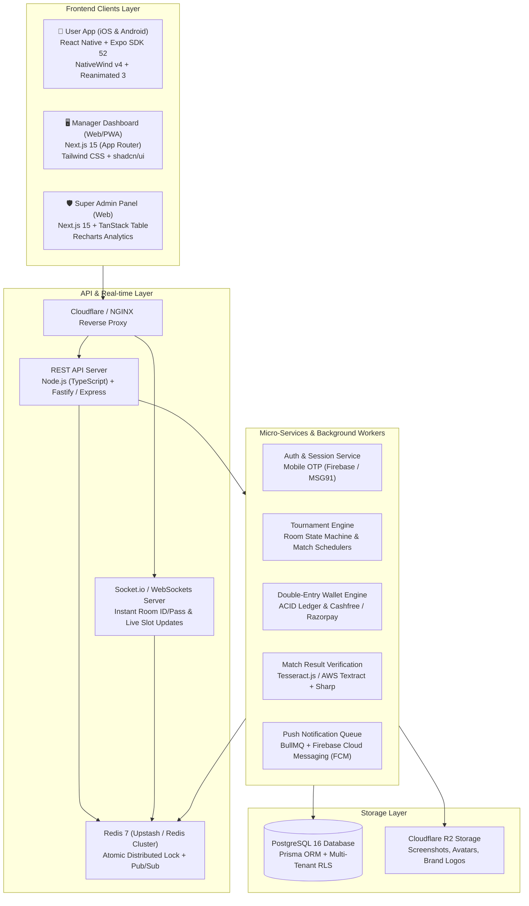
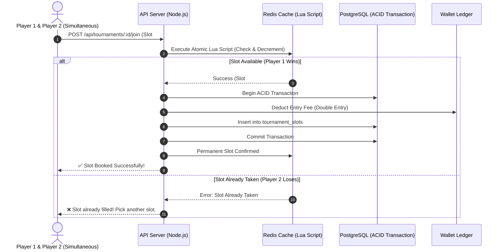
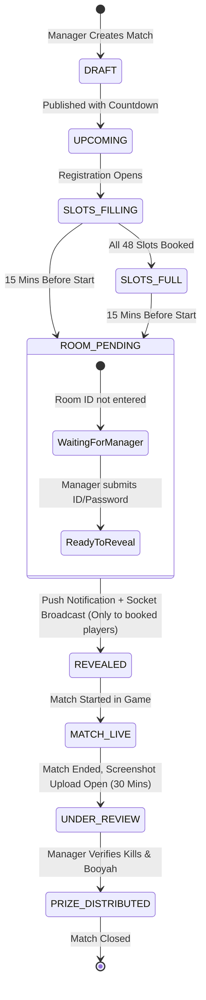

#  🎮 Free Fire Tournament Platform - Full App Research &amp; Technical Blueprint (Hinglish)

> **Document Type:** Full Technical &amp; Product Research Document  
> **Target Project:** Multi-Tenant / White-Label Esports Tournament SaaS Platform (Exclusively for Free Fire &amp; Free Fire MAX)  
> **Source Directive:** Boss WhatsApp Requirements (`boss demand/WP.txt`)  
> **Lead Developer:** Jay Kumar  
> **Target UX:** iOS / iPhone App Grade (Glassmorphism, Cupertino Physics, Dual OLED Dark &amp; Crisp Light Mode)  
> **Architecture Model:** 3-Tier Multi-Tenant Architecture (Super Admin Web + Manager Web/PWA + Gamer Mobile App)

---

## 📋 Table of Contents (Index)

1. [Executive Summary &amp; Boss Requirements Breakdown](#1-executive-summary--boss-requirements-breakdown)
2. [Market &amp; Competitor Analysis (WinZO, Gamerji, Khiladi Adda, Battlemania)](#2-market--competitor-analysis)
3. [Recommended Tech Stack &amp; Architecture Blueprint](#3-recommended-tech-stack--architecture-blueprint)
4. [Multi-Tenant White-Label Architecture (Ek App, Multiple Organizers)](#4-multi-tenant-white-label-architecture)
5. [Triple-Panel Feature Specifications (Admin, Manager, User)](#5-triple-panel-feature-specifications)
6. [High-Concurrency Slot Booking &amp; Race Condition Prevention (Redis Mutex)](#6-high-concurrency-slot-booking--race-condition-prevention)
7. [Free Fire Match Lifecycle &amp; Timed Room Credential Engine](#7-free-fire-match-lifecycle--timed-room-credential-engine)
8. [Match Result, OCR Screenshot Verification &amp; Anti-Cheat Pipeline](#8-match-result-ocr-screenshot-verification--anti-cheat-pipeline)
9. [Financial Ledger, Double-Entry Wallet &amp; Payment Gateways](#9-financial-ledger-double-entry-wallet--payment-gateways)
10. [iOS-Grade UI/UX Design System &amp; Component Guidelines](#10-ios-grade-uiux-design-system--component-guidelines)
11. [Complete Database Schema (PostgreSQL / Prisma ORM)](#11-complete-database-schema)
12. [Security, Anti-Fraud &amp; Legal Compliance (India Esports Law)](#12-security-anti-fraud--legal-compliance)
13. [GitHub Reference Repositories &amp; Step-by-Step Action Plan](#13-github-reference-repositories--step-by-step-action-plan)

---

## 1. Executive Summary &amp; Boss Requirements Breakdown

Boss ki chat (`boss demand/WP.txt`) ko analyze karne ke baad saare core requirements aur unka deep technical breakdown:

### 1.1 Boss Ke Directives vs Technical Implementation


| Boss Ki Demand (`WP.txt`)                                                                                    | Technical Interpretation                         | Engineering Strategy &amp; Implementation                                                                                                                                                                                                                                                               |
| :------------------------------------------------------------------------------------------------------------ | :------------------------------------------------ | :------------------------------------------------------------------------------------------------------------------------------------------------------------------------------------------------------------------------------------------------------------------------------------------------------- |
| **"Dekho ye jo project banaoge ye sirf ak bande ko sell karne ke liye nhi hoga multiple clite do dena hai"** | **Multi-Tenant White-Label SaaS Architecture**   | Ek centralized core backend banega. Har client (Tournament Organizer) ko apna tenant dashboard, custom branding (logo, theme color, banners), aur separate payment gateway credentials milenge. Database me `tenant_id` based data isolation rahega.                                                    |
| **"Html se bas mat banana... React me pura app"**                                                            | **Modern Component-Driven Tech Stack**           | Plain static HTML/CSS use nahi hoga. Mobile App **React Native + Expo** me banegi (iOS + Android support ke sath). Web Dashboards **Next.js 15 (React) + Tailwind CSS + shadcn/ui** me banenge.                                                                                                         |
| **"Iso . iPhone app ke jaisa modern ui rakhna"**                                                             | **Apple Human Interface Guidelines (HIG)**       | Cupertino-style glassmorphic blur effects (`expo-blur`), smooth spring micro-animations (`react-native-reanimated`), bottom sheet drawers (`@gorhom/bottom-sheet`), haptic vibrations (`expo-haptics`), aur 20px-24px rounded cards.                                                                    |
| **"Light mode dark mode rakhna"**                                                                            | **Native Dual Theme Engine**                     | Tailored Dark Gaming Theme (OLED Deep Space Black `#0B0E14` with Cyberpunk Orange/Crimson accents) aur Clean Light Theme (Apple Crisp Clean White `#FFFFFF` with Slate Gray `#0F172A`). System setting aur manual toggle dono supported honge.                                                          |
| **"Admin panel maneger panel and user panel"**                                                               | **3-Tier Role-Based Access Control (RBAC)**      | 1. **Super Admin Panel** (Platform Owner - Jay &amp; Boss ke liye)<br>2. **Manager Panel** (Client/Organizer ke liye - matches create karna, room ID/pass manage karna, results approve karna)<br>3. **User App** (Free Fire gamers ke liye - matches join karna, room pass dekhna, wallet aur payouts) |
| **"Fichar advance banana, Ui security me dekh lunga"**                                                       | **Advanced Automation &amp; High-Tech Features** | Race condition slot locking (Redis atomic lock), match start se 15 min pehle timed room credential release, screenshot OCR kill counter, aur bulletproof double-entry wallet ledger.                                                                                                                    |
| **"Banate time mughe preview dikhate rahna"**                                                                | **Live Previews &amp; Staging Environments**     | Mobile App ke liye **Expo Go / Expo Snack previews** aur Web Dashboards ke liye **Vercel / Cloudflare Pages staging URLs** deploy kiye jayenge taaki boss real-time me test kar sakein.                                                                                                                 |


---

## 2. Market &amp; Competitor Analysis

Indian esports market me Free Fire tournaments chalane wale major apps (jaise **WinZO, Gamerji, Khiladi Adda, Battlemania, Tournafest**) ka gehra analysis:

```
┌─────────────────────────────────────────────────────────────────────────────┐
│                       COMPETITOR BENCHMARK TABLE                            │
├──────────────┬──────────────────────────────┬───────────────────────────────┤
│ App / Platform│ Strengths (Achhi Khasiyaten)  │ Weaknesses & Gaps (Flaws)     │
├──────────────┼──────────────────────────────┼───────────────────────────────┤
│ Gamerji      │ • Multi-game support         │ • UI kafi crowded aur slow hai│
│              │ • Automated bracket system   │ • Custom room pass late milta │
├──────────────┼──────────────────────────────┼───────────────────────────────┤
│ Khiladi Adda │ • Fast instant UPI cashouts  │ • Outdated Android-only UI    │
│              │ • Large user community       │ • Rush hours par server lag   │
├──────────────┼──────────────────────────────┼───────────────────────────────┤
│ Battlemania  │ • Free Fire dedicated rooms  │ • Manual manager verification │
│              │ • Custom slot selection      │ • Fake screenshot fraud zyada │
├──────────────┼──────────────────────────────┼───────────────────────────────┤
│ WinZO        │ • Instant payouts, high scale│ • Custom room matches me      │
│              │ • Millions of active players │   organizer branding missing  │
└──────────────┴──────────────────────────────┴───────────────────────────────┘
```

### 2.1 Humare App Ka Winning Advantage (USPs)

1. **Zero Fake Screenshot Fraud:** Perceptual Image Hashing (pHash) aur auto OCR kill counter, jisse duplicate ya Photoshop kiye hue fake screenshots automatic reject ho jate hain.
2. **Instant Room Distribution Engine:** Match shuru hone ke theek 15 minute pehle auto notification + WebSocket push, jisse WhatsApp/Telegram par room ID leak hone ka jhanjhat khatam ho jata hai.
3. **Flawless High-Concurrency:** Match shuru hone se 5 minute pehle jab hazaron players ek sath room ID lene ya last slot book karne aate hain, tab Redis in-memory cache ki wajah se server zero down rehta hai.
4. **Apple-Grade Modern UI:** Android aur iOS dono devices par ultra-smooth iPhone jaisa feel, glassmorphism aur fluid spring gestures ke sath.

---

## 3. Recommended Tech Stack &amp; Architecture Blueprint



### 3.1 Tech Stack Justification Table


| Module                               | Recommended Technology                         | Boss Ki Requirement Se Match Kyu Karta Hai?                                                                                                                               |
| :------------------------------------ | :---------------------------------------------- | :------------------------------------------------------------------------------------------------------------------------------------------------------------------------- |
| **Mobile App (Player)**              | **React Native (Expo SDK 52) + NativeWind v4** | Boss ne kaha "React me pura app aur iPhone jaisa modern UI". Expo se ek hi code se iOS aur Android dono banta hai. NativeWind se Tailwind styling super-easy ho jati hai. |
| **Web Panels (Admin &amp; Manager)** | **Next.js 15 + shadcn/ui + Lucide Icons**      | Super-fast SSR, clean Apple-like modern dashboard components out-of-the-box, lightweight aur highly scalable.                                                             |
| **Backend Framework**                | **Node.js (TypeScript) + Fastify / Express**   | Fast event loop, asynchronous IO, high concurrency handle karne ke liye best. TypeScript se bugs pehle hi pakad aate hain.                                                |
| **Realtime Engine**                  | **Socket.io + Redis Adapter**                  | Room ID aur Password live reveal karne ke liye real-time websocket chahiye taaki page refresh na karna pade.                                                              |
| **Database**                         | **PostgreSQL 16 + Prisma ORM**                 | Relational transactions (ACID) zaroori hain taaki paise ka hisab aur slot booking 100% accurate rahe.                                                                     |
| **Cache &amp; Locks**                | **Redis (Redlock / Lua Scripts)**              | Microsecond speed slot availability check aur race condition lock karne ke liye.                                                                                          |
| **File Storage**                     | **Cloudflare R2**                              | Zero egress fees! Hazaron players match ke screenshot upload karenge toh AWS S3 ka bill mehenga ho sakta hai, R2 bilkul sasta padta hai.                                  |


---

## 4. Multi-Tenant White-Label Architecture

Boss ka main commercial plan hai: **"Ye sirf ek bande ke liye nahi hai, multiple clients ko bechna hai."**

Iska matlab yeh ek **White-Label SaaS Platform** banega jaha alag-alag esports organizers apna business chala sakenge.

```
                    ┌────────────────────────┐
                    │  SUPER ADMIN PLATFORM  │
                    │ (Jay & Boss Control)   │
                    └───────────┬────────────┘
                                │
         ┌──────────────────────┴──────────────────────┐
         │                                             │
┌────────┴─────────────┐                     ┌─────────┴────────────┐
│ CLIENT 1:            │                     │ CLIENT 2:            │
│ "Alpha Esports"      │                     │ "Thunder Tourneys"   │
│ Subdomain:           │                     │ Subdomain:           │
│ alpha.tourney.com    │                     │ thunder.tourney.com  │
│ Custom Theme: Crimson│                     │ Custom Theme: Blue   │
│ Apna Razorpay Key    │                     │ Apna Cashfree Key    │
│ Apne Free Fire Rooms │                     │ Apne Free Fire Rooms │
└──────────────────────┘                     └──────────────────────┘
```

### 4.1 Data Isolation Model: Shared DB with Tenant ID &amp; Row Level Security

Multi-tenant banane ke 3 models hote hain:

1. *Separate Database per client* -&gt; Mehenga aur maintain karna mushkil.
2. *Separate Schema per client* -&gt; Migrations run karne me problem aati hai.
3. **Shared Database with `tenant_id` Column (Recommended)** -&gt; Sabse cost-effective, easily scalable, aur PostgreSQL Row Level Security (RLS) se 100% secure.

Har query me backend automatically verify karta hai:

```sql
SELECT * FROM tournaments WHERE tenant_id = 'client_uuid_here' AND status = 'OPEN';
```

### 4.2 Dynamic White-Label Theme Configuration

Har client ko ek JSON configuration milti hai jo app load hote hi sync hoti hai:

```json
{
  "tenant_id": "tenant_alpha_esports",
  "brand_name": "Alpha Esports Club",
  "logo_url": "https://r2.tourney.com/tenants/alpha/logo.png",
  "splash_banner": "https://r2.tourney.com/tenants/alpha/banner.jpg",
  "theme": {
    "primary_color": "#FF4655",
    "accent_color": "#FFC700",
    "dark_background": "#0B0E14",
    "light_background": "#F8FAFC"
  },
  "payment_gateways": {
    "cashfree_enabled": true,
    "upi_qr_manual_enabled": true
  },
  "support_links": {
    "whatsapp_group": "https://chat.whatsapp.com/xyz",
    "youtube_channel": "https://youtube.com/@alphaesports",
    "instagram": "https://instagram.com/alphaesports"
  }
}
```

---

## 5. Triple-Panel Feature Specifications

Boss ne specifically bola hai: **"Admin panel maneger panel and user panel"**. Teeno panels ke detailed features:

```
                  ┌─────────────────────────────────────────┐
                  │        ROLE-BASED PANELS MATRIX         │
                  └────────────────────┬────────────────────┘
                                       │
        ┌──────────────────────────────┼──────────────────────────────┐
        │                              │                              │
┌───────┴──────────────┐     ┌─────────┴────────────┐     ┌───────────┴──────────┐
│ 1. SUPER ADMIN PANEL │     │ 2. MANAGER PANEL     │     │ 3. USER MOBILE APP   │
│ (Web Dashboard)      │     │ (Web Dashboard / PWA)│     │ (iOS & Android)      │
├──────────────────────┤     ├──────────────────────┤     ├──────────────────────┤
│• Tenant Provisioning │     │• Match Creation      │     │• One-Tap OTP Login   │
│• SaaS License Plans  │     │• Solo/Duo/Squad/CS   │     │• Tournament Feed     │
│• Global Platform Cut │     │• Custom Room ID/Pass │     │• Interactive Slots   │
│• Payment Gateway Hub │     │• Timed Auto Release  │     │• Timed Room Popup    │
│• Universal Ban List  │     │• Fast Result Review  │     │• Dual In-App Wallet  │
│• Server Health Stats │     │• Prize Distribution  │     │• Screenshot Upload   │
└──────────────────────┘     └──────────────────────┘     └──────────────────────┘
```

### 5.1 Super Admin Panel (Platform Owner - Jay &amp; Boss)

1. **Client (Tenant) Management:** Naye client ko onboard karna, custom sub-domain assign karna, license validity set karna (Monthly/Yearly SaaS plan).
2. **Platform Commission Engine:** Har match ki entry fee me se platform ka cut (e.g. 5% ya flat 2 Rs per player) automatically platform wallet me aana.
3. **Master Ban Hub:** Cheater / hacker ko global level par Device ID aur Phone number se ban karna taaki wo kisi bhi client ke match me na ghus sake.
4. **Master Analytics:** Total active users across all clients, daily tournament volume, total revenue processed.
5. **Gateway Health:** Payment gateway failure rates aur SMS OTP delivery status monitor karna.

### 5.2 Manager Panel (Organizer / Client Dashboard)

1. **Match Creation Wizard:**
   - **Game Type:** Free Fire Classic Battle Royale / Clash Squad (CS 4v4 / 6v6).
   - **Format:** Solo (48 players), Duo (24 teams), Squad (12 teams).
   - **Map:** Bermuda, Purgatory, Kalahari, Alpine, NexTerra.
   - **Entry Fee &amp; Prize Pool:** Entry Fee per player, Per-Kill Bounty, Rank 1/2/3 prizes auto-calculate karna.
2. **Room Credentials Dispatcher:**
   - Free Fire Custom Room ID aur Password input karna.
   - Timer set karna: Automatic countdown jo match start hone se 15 minute pehle user app par reveal karega.
3. **Player Slot Management:**
   - Real-time slot view dekhna ki kaun sa player kis slot me register hua hai.
   - Agar koi fake ya rule-breaker user hai toh usse match se kick/refund karna.
4. **Result Approval Console:**
   - Players ke upload kiye gaye screenshot split-screen me dekhna.
   - Kill count verify karke single click me winner declare karna aur wallet me prize credit karna.
5. **Client Wallet &amp; Settlements:**
   - Match ki bachi hui commission apne bank account / UPI me withdraw karna.

### 5.3 User Mobile App (Player / Gamer Experience)

1. **Modern iOS Onboarding:** Phone number se instant OTP login, Free Fire in-game UID aur IGN (In-Game Name) profile setup.
2. **Tournament Discovery Feed:**
   - Filter by: Solo, Duo, Squad, Clash Squad, Free Matches, High Stakes.
   - Real-time progress bar (e.g., "38/48 Slots Filled").
3. **Interactive Slot Picker (Free Fire Lobby Style):**
   - Player apni marzi se Slot 1 se Slot 48 tak select kar sakta hai (Duo/Squad me teammates ke sath ek hi squad me slot book karna).
4. **Timed Room Reveal Modal:**
   - Match shuru hone se 15 min pehle haptic feedback ke sath Room ID aur Pass popup aayega.
   - **One-Tap Copy Button:** Free Fire game me jakar paste karne ke liye.
5. **In-App Dual Wallet:**
   - **Deposit Cash:** Tournament me entry lene ke liye.
   - **Winning Cash:** Matches jeetne par aane wala balance jisse instant UPI/Bank account me withdraw kiya ja sake.
6. **Match Result Submission:**
   - Match khatam hone ke baad score screenshot camera ya gallery se upload karna.
7. **Leaderboard &amp; Player Career:**
   - Total matches played, total kills, Booyah count, win rate percentage.

---

## 6. High-Concurrency Slot Booking &amp; Race Condition Prevention

### 6.1 The Big Technical Problem (Race Condition)

Jab koi popular Free Fire match khulta hai (e.g. Entry Rs 20, Prize Rs 800), tab match me aakhri 2 slots bache hote hain aur 100+ players ek hi second me **"Join Now"** dabate hain.

Agar normal database query lagayi (`SELECT remaining_slots`, then `UPDATE`):
➡️ **Overbooking ho jayegi!** 48 slots ke match me 55 players book ho jayenge, aur baki players ka paisa katne ke baad app crash ho jayegi.

### 6.2 The Solution: Redis Distributed Lock &amp; Atomic Lua Script

Hum **Redis In-Memory Atomic Operation** use karenge. Database touch karne se pehle Redis me microsecond level par slot lock kiya jata hai.



### 6.3 Production-Ready Atomic Lua Script (TypeScript Implementation)

```typescript
// redisSlotLocker.ts
import Redis from 'ioredis';

const redis = new Redis(process.env.REDIS_URL!);

// Lua Script ensures atomicity: Check balance + Check slot + Reserve
const reserveSlotLuaScript = `
  local tournamentKey = KEYS[1]
  local slotKey = KEYS[2]
  local userId = ARGV[1]
  local maxSlots = tonumber(ARGV[2])
  local requestedSlot = ARGV[3]
  
  -- Check total occupied count
  local currentCount = redis.call('SCARD', tournamentKey)
  if currentCount >= maxSlots then
    return -1 -- Tournament is FULL
  end
  
  -- Check if this specific slot is already taken
  local isTaken = redis.call('HEXISTS', slotKey, requestedSlot)
  if isTaken == 1 then
    return -2 -- Specific slot already booked
  end
  
  -- Reserve slot temporarily (10 seconds lock)
  redis.call('HSET', slotKey, requestedSlot, userId)
  redis.call('SADD', tournamentKey, userId)
  return 1 -- Successfully reserved!
`;

export async function attemptJoinTournament(
  tournamentId: string,
  userId: string,
  slotNumber: number,
  maxSlots: number
) {
  const tournamentKey = `tournament:${tournamentId}:players`;
  const slotKey = `tournament:${tournamentId}:slots`;

  const result = await redis.eval(
    reserveSlotLuaScript,
    2,
    tournamentKey,
    slotKey,
    userId,
    maxSlots,
    slotNumber.toString()
  );

  if (result === -1) {
    throw new Error('Tournament full ho chuka hai!');
  }
  if (result === -2) {
    throw new Error(`Slot #${slotNumber} already kisi aur ne le liya hai!`);
  }

  return { success: true, slotNumber };
}
```

---

## 7. Free Fire Match Lifecycle &amp; Timed Room Credential Engine

Free Fire tournament ka sabse sensitive hissa hota hai: **Room ID aur Password ka distribution**.

Agar room ID pehle leak ho gayi, toh bahar ke random players Free Fire custom room me ghus jayenge aur registered player bahar reh jayenge.



### 7.1 Timed Credential Security Checklist

1. **Never Send Room Pass in Initial Match Data:** Jab player tournament feed scroll karta hai, API response me `room_password: null` hona chahiye.
2. **Authenticated Endpoint with Time-Lock:**
   - Endpoint: `GET /api/tournaments/:id/room-credentials`
   - Server checks:
   a) Kya user is tournament ka verified slot holder hai?
   b) Kya current time &gt;= (match\_time - 15 minutes) hai?
   c) Agar dono true hain, tabhi encrypted room ID &amp; Pass return hoga.
3. **FCM Push Notification Trigger:**
 Jaise hi match time se 15 minute pehle manager ID/Pass daalta hai, ek background BullMQ worker saare 48 players ko High-Priority FCM Push Notification trigger karega:
   > *"🔥 Free Fire Room ID &amp; Password live ho chuka hai! Jaldi se app kholkar room me join karein."*

---

## 8. Match Result, OCR Screenshot Verification &amp; Anti-Cheat Pipeline

Esports apps me sabse zyada jhagde match results aur fake screenshots par hote hain. Players internet se purana screenshot utha kar daal dete hain ya Photoshop se kill count badha dete hain.

### 8.1 4-Layer Screenshot Verification Pipeline

```
  Player Submits Free Fire End-Game Screenshot
                       │
                       ▼
       [LAYER 1: EXIF & Timestamp Check]
       • Kya screenshot pichle 45 minutes ke andar click hua hai?
       • Kya image me screenshot metadata valid hai?
                       │
                       ▼
       [LAYER 2: Perceptual Hashing (pHash)]
       • Duplicate Image Detection: Kya kisi aur user ne same 
         image hash pehle hi upload toh nahi kar diya?
                       │
                       ▼
       [LAYER 3: OCR Text Extraction (Tesseract / AWS Textract)]
       • Image me se "BOOYAH", "Rank #1", "Kills: X", aur 
         Player In-Game Name (IGN) scan karke auto-fill karna.
                       │
                       ▼
       [LAYER 4: Manager Fast-Review Console]
       • Split-Screen UI jisme manager ko OCR detected kills 
         aur actual image side-by-side dikhti hai. 
       • 1-Click "Approve & Payout" ya "Reject".
```

### 8.2 Standard Free Fire Scoring Formula (Automatic Calculator)

```typescript
// scoreCalculator.ts
export interface PlayerMatchResult {
  userId: string;
  inGameName: string;
  rank: number;
  kills: number;
}

export function calculateEarnings(
  result: PlayerMatchResult,
  perKillBounty: number,
  rankPrizes: Record<number, number>
): number {
  const killEarnings = result.kills * perKillBounty;
  const rankEarnings = rankPrizes[result.rank] || 0;
  
  return killEarnings + rankEarnings;
}

// Example: Free Fire Duo Match
// Entry: Rs 30, Per Kill: Rs 15, Rank 1: Rs 200, Rank 2: Rs 100
// Player has 4 Kills + Rank 1 (Booyah!)
// Total Prize = (4 * 15) + 200 = Rs 260
```

---

## 9. Financial Ledger, Double-Entry Wallet &amp; Payment Gateways

Tournament apps me financial accuracy sabse zaroori hoti hai. Agar ek rupee ka bhi hisab gadbad hua toh players ka trust khatam ho jata hai.

### 9.1 Double-Entry Bookkeeping Rule

Kabhi bhi database me sirf `UPDATE users SET balance = balance + 100` nahi karna chahiye!
Hamesha **Double-Entry Ledger** maintain hota hai jisme har transaction ka credit, debit, balance after transaction aur reference ID track hoti hai.

```
┌─────────────────────────────────────────────────────────────────────────────┐
│                          WALLET LEDGER ARCHITECTURE                         │
├──────────────────────┬─────────────────┬─────────────────┬──────────────────┤
│ Transaction Type     │ Deposit Balance │ Winning Balance │ Reference ID     │
├──────────────────────┼─────────────────┼─────────────────┼──────────────────┤
│ 1. Add Cash (UPI)    │ + Rs 100        │ Rs 0            │ Pay_12389        │
│ 2. Join Match #402   │ - Rs 30         │ Rs 0            │ Tourn_402        │
│ 3. Won Match #402    │ Rs 0            │ + Rs 150        │ Win_402          │
│ 4. Instant Cashout   │ Rs 0            │ - Rs 150        │ Wth_99812        │
└──────────────────────┴─────────────────┴─────────────────┴──────────────────┘
```

### 9.2 Payment Gateway Integration Strategy

1. **Cashfree / Razorpay (Auto Gateway):** For large clients who have business GST/current account. Instant webhook callbacks for auto deposit and auto UPI payout.
2. **UPI Dynamic QR Code (For Small Organizers):**
   - Agar chote organizers ke paas merchant account nahi hai, toh app unka personal UPI ID use karke dynamic QR code generate karegi (amount pre-filled).
   - User transaction UTR number daalega aur manager panel se 1-click verify karega.

---

## 10. iOS-Grade UI/UX Design System &amp; Component Guidelines

Boss ne specifically instruction di hai: **"iOS / iPhone app ke jaisa modern ui rakhna"** aur **"Light mode dark mode rakhna"**.

Apple Human Interface Guidelines (HIG) ko match karne ke liye design tokens aur components:

### 10.1 Design Tokens (Tailwind &amp; NativeWind)

```javascript
// tailwind.config.js - iOS Gaming Theme
module.exports = {
  darkMode: 'class',
  theme: {
    extend: {
      colors: {
        ios: {
          darkBg: '#0B0E14',        // OLED Deep Space Black
          darkCard: '#151922',      // Glassmorphic Card Surface
          darkBorder: '#232936',    // Subtle Border
          lightBg: '#F8F9FA',       // Apple Crisp Clean Background
          lightCard: '#FFFFFF',     // Pure White Card
          lightBorder: '#E2E8F0',   // Soft Slate Border
          primary: '#FF4757',       // Free Fire Crimson Orange
          accent: '#70A1FF',        // Electric Blue Accent
          success: '#2ED573',       // Neon Win Green
          warning: '#FFA502',       // Booyah Gold
        }
      },
      borderRadius: {
        'ios-sm': '12px',
        'ios-md': '16px',
        'ios-lg': '24px',          // Apple Signature Smooth Corners
        'ios-full': '9999px',
      },
      boxShadow: {
        'ios-dark': '0 8px 32px 0 rgba(0, 0, 0, 0.45)',
        'ios-light': '0 4px 20px 0 rgba(0, 0, 0, 0.06)',
      }
    }
  }
}
```

### 10.2 Signature iOS UI Components to Build

1. **Cupertino Glassmorphism Card (Tournament Card):**
   - Use `expo-blur` (`BlurView intensity={40} tint="dark"`).
   - Rounded corners `rounded-[20px]`.
   - Subtle 1px gradient border (`border border-white/10`).
2. **Interactive Bottom Sheet Drawer:**
   - React Native me `@gorhom/bottom-sheet` use karna.
   - Smooth drag gesture aur spring physics jab player match details ya slot select karta hai.
3. **Slide-to-Confirm Swipe Button (iOS Style):**
   - Match join karte waqt ya withdrawal request karte waqt accidental click rokne ke liye "Slide to Join" button.
4. **Haptic Feedback:**
   - `expo-haptics` ka use har action par:
     - Slot tap karne par: `Haptics.impactAsync(Haptics.ImpactFeedbackStyle.Light)`
     - Payment confirm hone par: `Haptics.notificationAsync(Haptics.NotificationFeedbackType.Success)`
     - Error aane par: `Haptics.notificationAsync(Haptics.NotificationFeedbackType.Error)`

---

## 11. Complete Database Schema (PostgreSQL / Prisma ORM)

Yeh production-ready Prisma schema multi-tenant SaaS, wallet ledger, aur Free Fire matches ko handle karta hai:

```prisma
// schema.prisma
datasource db {
  provider = "postgresql"
  url      = env("DATABASE_URL")
}

generator client {
  provider = "prisma-client-js"
}

// 1. TENANT (CLIENT / TOURNAMENT ORGANIZER)
model Tenant {
  id              String         @id @default(uuid())
  subdomain       String         @unique // e.g. "alpha" -> alpha.tourney.com
  brandName       String
  logoUrl         String?
  primaryColor    String         @default("#FF4757")
  commissionRate  Float          @default(10.0) // 10% commission on matches
  cashfreeApiKey  String?
  razorpayKey     String?
  upiId           String?
  isActive        Boolean        @default(true)
  createdAt       DateTime       @default(now())
  
  users           User[]
  tournaments     Tournament[]
  walletLedgers   WalletLedger[]
}

// 2. USER PROFILE (GAMERS & MANAGERS)
model User {
  id              String         @id @default(uuid())
  tenantId        String
  tenant          Tenant         @relation(fields: [tenantId], references: [id])
  phoneNumber     String
  inGameName      String         // Free Fire IGN (e.g. "RAISTAR_99")
  inGameUid       String         // Free Fire UID (e.g. "1928374612")
  role            Role           @default(USER) // SUPER_ADMIN, MANAGER, USER
  depositBalance  Decimal        @default(0.00) @db.Decimal(10, 2)
  winningBalance  Decimal        @default(0.00) @db.Decimal(10, 2)
  isBanned        Boolean        @default(false)
  deviceId        String?
  createdAt       DateTime       @default(now())

  slots           TournamentSlot[]
  ledgers         WalletLedger[]
  matchResults    MatchResult[]

  @@unique([tenantId, phoneNumber])
  @@index([tenantId, inGameUid])
}

enum Role {
  SUPER_ADMIN
  MANAGER
  USER
}

// 3. TOURNAMENT (FREE FIRE MATCHES)
model Tournament {
  id              String            @id @default(uuid())
  tenantId        String
  tenant          Tenant            @relation(fields: [tenantId], references: [id])
  title           String            // e.g. "Daily Bermuda Squad Bash #102"
  gameMode        GameMode          // BATTLE_ROYALE, CLASH_SQUAD
  matchType       MatchType         // SOLO, DUO, SQUAD
  mapType         MapType           // BERMUDA, PURGATORY, KALAHARI, ALPINE
  entryFee        Decimal           @db.Decimal(10, 2)
  prizePool       Decimal           @db.Decimal(10, 2)
  perKillPrize    Decimal           @default(0.00) @db.Decimal(10, 2)
  totalSlots      Int               @default(48)
  matchTime       DateTime
  status          TournamentStatus  @default(UPCOMING)
  
  // Custom Room Credentials (Encrypted until 15 mins before match)
  roomId          String?
  roomPassword    String?
  roomRevealedAt  DateTime?

  createdAt       DateTime          @default(now())
  
  slots           TournamentSlot[]
  results         MatchResult[]

  @@index([tenantId, status, matchTime])
}

enum GameMode {
  BATTLE_ROYALE
  CLASH_SQUAD
}

enum MatchType {
  SOLO
  DUO
  SQUAD
}

enum MapType {
  BERMUDA
  PURGATORY
  KALAHARI
  ALPINE
  NEXTERRA
}

enum TournamentStatus {
  DRAFT
  UPCOMING
  OPEN
  SLOTS_FULL
  ROOM_REVEALED
  LIVE
  UNDER_REVIEW
  COMPLETED
  CANCELLED
}

// 4. TOURNAMENT SLOTS (ANTI-OVERBOOKING)
model TournamentSlot {
  id            String      @id @default(uuid())
  tournamentId  String
  tournament    Tournament  @relation(fields: [tournamentId], references: [id])
  userId        String
  user          User        @relation(fields: [userId], references: [id])
  slotNumber    Int         // 1 to 48
  teamId        String?     // For Duo / Squad grouping
  joinedAt      DateTime    @default(now())

  @@unique([tournamentId, slotNumber]) // Ek slot pe do log nahi ho sakte
  @@unique([tournamentId, userId])     // Ek match me ek user do baar nahi join kar sakta
}

// 5. DOUBLE-ENTRY WALLET LEDGER
model WalletLedger {
  id              String          @id @default(uuid())
  tenantId        String
  tenant          Tenant          @relation(fields: [tenantId], references: [id])
  userId          String
  user            User            @relation(fields: [userId], references: [id])
  amount          Decimal         @db.Decimal(10, 2)
  balanceType     BalanceType     // DEPOSIT or WINNING
  type            TransactionType // CREDIT or DEBIT
  category        Category        // ADD_MONEY, JOIN_FEE, WINNING_PRIZE, WITHDRAWAL, REFUND
  balanceAfter    Decimal         @db.Decimal(10, 2)
  referenceId     String?         // Razorpay ID / Tournament ID
  notes           String?
  createdAt       DateTime        @default(now())

  @@index([userId, createdAt])
}

enum BalanceType {
  DEPOSIT
  WINNING
}

enum TransactionType {
  CREDIT
  DEBIT
}

enum Category {
  ADD_MONEY
  JOIN_FEE
  WINNING_PRIZE
  WITHDRAWAL
  REFUND
}

// 6. MATCH RESULT & SCREENSHOT PROOF
model MatchResult {
  id              String          @id @default(uuid())
  tournamentId    String
  tournament      Tournament      @relation(fields: [tournamentId], references: [id])
  userId          String
  user            User            @relation(fields: [userId], references: [id])
  screenshotUrl   String
  imageHash       String?         // Duplicate detection (pHash)
  detectedKills   Int?            // OCR auto extracted kills
  verifiedKills   Int             @default(0)
  rank            Int?            // e.g. 1 for Booyah!
  prizeWon        Decimal         @default(0.00) @db.Decimal(10, 2)
  isApproved      Boolean         @default(false)
  reviewedAt      DateTime?

  @@unique([tournamentId, userId])
}
```

---

## 12. Security, Anti-Fraud &amp; Legal Compliance

Boss ne bola tha: **"Ui security me dekh lunga... feature advance banana"**. Lekin platform banate waqt hume pehle din se security architecture tayar rakhna hai:

### 12.1 Anti-Fraud &amp; Anti-Hack Shield

1. **Multi-Account Ban (Device Fingerprinting):**
   - Ek player multiple fake accounts banakar apne hi doston ko kill karke per-kill bounty chori karta hai.
   - Solution: Mobile device ka unique hardware UUID track karna (`expo-application` / `react-native-device-info`). Ek device par maximum 1 active account allowed hoga.
2. **Root &amp; Jailbreak Detection:**
   - Rooted phones me game memory modify karke hacks run kiye jate hain.
   - Solution: App launch hote hi root/jailbreak check karna (`jail-monkey` library).
3. **Custom Room Leaker Tracking:**
   - Agar kisi player ne room ID/Pass WhatsApp group me leak kiya, toh room me enter hone wale players ki in-game UID match ki jati hai app me registered slot holders se. Unregistered players ko Free Fire custom room se turant kick kiya jata hai.

### 12.2 Legal Compliance (India Esports Law)

1. **Game of Skill Exemption:**
   - Free Fire ek Esports video game hai jo "Game of Skill" me aata hai under Indian High Court &amp; Supreme Court rulings (unlike pure chance gambling).
   - Andhra Pradesh, Assam, Odisha, Telangana, Sikkim, Nagaland jaise restricted states ke liye geolocation blocking lagana zaroori hai.
2. **KYC &amp; TDS (Section 194BA):**
   - Rs 10,000+ ke high-volume withdrawals ke liye PAN card / Aadhaar verification zaroori hota hai.

---

## 13. GitHub Reference Repositories &amp; Step-by-Step Action Plan

Jay ke immediate reference ke liye top open-source projects aur boilerplates jinse UI aur logic borrow kiya ja sakta hai:

### 13.1 Best GitHub Repositories to Inspect


| Project / Repo                             | Purpose &amp; Modules to Reference                                                     | Tech Stack                |
| :------------------------------------------ | :-------------------------------------------------------------------------------------- | :------------------------- |
| **`gorhom/react-native-bottom-sheet`**     | iOS-style smooth interactive bottom sheets (match details &amp; slot booking ke liye). | React Native + Reanimated |
| **`shadcn-ui/ui`**                         | Super Admin &amp; Manager Web Dashboard ke liye clean, modern components.              | Next.js + Tailwind        |
| **`tesseract.js`**                         | Client-side ya server-side Free Fire screenshot OCR kill extraction.                   | Node.js / WebAssembly     |
| **`mike-north/redlock`**                   | Distributed Redis lock for preventing slot booking race conditions.                    | Node.js + Redis           |
| **`lucide-react` / `lucide-react-native`** | Apple-grade minimalist vector icons.                                                   | React / React Native      |


### 13.2 Next Steps for Jay Kumar

1. **Boss ko Preview Dikhayein:**
   - Boss ko yeh `full app resarch.md` aur `ROADMAP.md` ka overview dikhayein taaki unhe tasalli ho jaye ki Multi-tenant architecture, iOS UI, aur advanced features ka solid blueprint tayar hai.
2. **Mobile App Starter (Expo + NativeWind):**
   - `npx create-expo-app@latest free-fire-app -t tabs` run karein.
   - NativeWind v4 aur Lucide icons setup karein.
3. **Admin &amp; Manager Panel Starter (Next.js 15):**
   - `npx create-next-app@latest admin-manager-portal` run karein with Tailwind and App Router.
4. **Prisma Database Setup:**
   - PostgreSQL database create karke schema push karein: `npx prisma db push`.