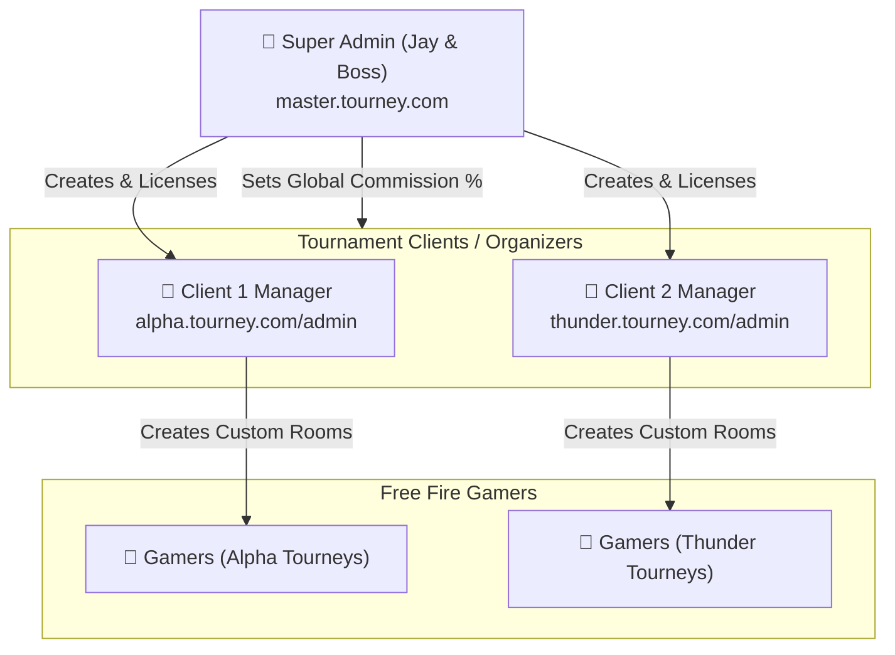

# 🏢 Free Fire Tournament - "One App, All Clients Sell" Architecture & Blueprint (Hinglish)

> **Document Type:** Multi-Tenant White-Label SaaS Architecture & Commercial Blueprint  
> **Target Goal:** Ek hi codebase se Free Fire tournament app banana jise hum **multiple clients (organizers) ko baar-baar sell kar sakein** bina har baar naya app banaye.  
> **Source Directive:** Boss WhatsApp Chat (`boss demand/WP.txt` - *"Ye sirf ek bande ko sell karne ke liye nahi hoga, multiple client ko dena hai"*)  
> **Lead Developer:** Jay Kumar  
> **Target UX:** Modern iOS / iPhone Style (Glassmorphism, Cupertino Physics, Dual Dark & Light Modes)

---

## 📋 Table of Contents (Index)

1. [Concept: "One Codebase, Infinite Clients" Kya Hai?](#1-concept-one-codebase-infinite-clients-kya-hai)
2. [Sell Karne Ke 3 Best Models (Clients Ko Kaise Bech Sakte Hain)](#2-sell-karne-ke-3-best-models)
3. [Multi-Tenant Database Architecture & Data Isolation (PostgreSQL RLS)](#3-multi-tenant-database-architecture--data-isolation)
4. [Sabse Bada Sawal: Paise Kisko Jayenge? (Payment Gateway Routing)](#4-sabse-bada-sawal-paise-kisko-jayenge-payment-gateway-routing)
5. [Triple-Panel Multi-Client Access Control (Super Admin vs Manager vs User)](#5-triple-panel-multi-client-access-control)
6. [Dynamic White-Label Branding Engine (Runtime Theme & Logo Injection)](#6-dynamic-white-label-branding-engine)
7. [Subdomain & Custom Domain Mapping (*.yourdomain.com)](#7-subdomain--custom-domain-mapping)
8. [License Protection & Anti-Theft System (Client Code Chori Na Kar Sake)](#8-license-protection--anti-theft-system)
9. [Pricing & Monetization Strategy (Boss Ke Business Ke Liye Plans)](#9-pricing--monetization-strategy)
10. [Step-by-Step Technical Implementation Roadmap for Jay](#10-step-by-step-technical-implementation-roadmap-for-jay)

---

## 1. Concept: "One Codebase, Infinite Clients" Kya Hai?

Jab boss ne kaha: **"Ye sirf ek bande ko sell karne ke liye nahi hoga, multiple client ko dena hai"**, toh traditional aur modern approaches me yeh antar hota hai:

### ❌ Purana / Galat Tarika (Traditional Multi-App Model)
* Har naye client ke liye alag se naya code copy-paste karna.
* Har client ke liye alag database, alag VPS server, alag APK compile karna.
* **Nuksan:** Agar app me ek bug aaya ya naya feature add kiya, toh aapko 20 alag-alag apps me code update karna padega aur 20 APKs dobara build karni padengi. Developer ka dimag kharab ho jayega!

### ✅ Naya / Smart Tarika (Multi-Tenant White-Label SaaS Model)
* **Single Core Backend:** Ek hi master server aur ek hi database rahega.
* **Tenant Isolation (`tenant_id`):** Har naye client ko ek unique ID mil jayegi (e.g., `client_alpha`, `client_thunder`).
* **Dynamic Customization:** App khulte hi check karegi ki user kis client ke platform par hai. Uske hisab se logo, app name, banner, accent color aur matches badal jayenge!
* **Fayda:** Ek bar bug fix kiya ya naya feature daala — **sab clients ko automatic update mil jayega!**

```
                            ┌────────────────────────┐
                            │    CENTRAL BACKEND     │
                            │ (Node.js + PostgreSQL) │
                            └───────────┬────────────┘
                                        │
         ┌──────────────────────────────┼──────────────────────────────┐
         │                              │                              │
         ▼                              ▼                              ▼
┌──────────────────┐           ┌──────────────────┐           ┌──────────────────┐
│ CLIENT A:        │           │ CLIENT B:        │           │ CLIENT C:        │
│ "Alpha Esports"  │           │ "Thunder Gaming" │           │ "Godlike Battles"│
│ Logo: Alpha Wolf │           │ Logo: Lightning  │           │ Logo: Golden Gun │
│ Theme: Neon Red  │           │ Theme: Sky Blue  │           │ Theme: Neon Gold │
│ Subdomain:       │           │ Subdomain:       │           │ Subdomain:       │
│ alpha.app.com    │           │ thunder.app.com  │           │ godlike.app.com  │
│ Own UPI/Gateway  │           │ Own UPI/Gateway  │           │ Own UPI/Gateway  │
└──────────────────┘           └──────────────────┘           └──────────────────┘
```

---

## 2. Sell Karne Ke 3 Best Models

Aapke boss is software ko market me **3 alag-alag tareeqon** se bech sakte hain. Client ki demand aur budget ke hisab se model choose kiya ja sakta hai:

```
┌─────────────────────────────────────────────────────────────────────────────┐
│                          3 WHITE-LABEL SALES MODELS                         │
├──────────────┬──────────────────────────────┬───────────────────────────────┤
│ Model Name   │ Client Ko Kya Milta Hai?     │ Best For & Setup Effort       │
├──────────────┼──────────────────────────────┼───────────────────────────────┤
│ Model 1:     │ Ek hi master app me apna     │ • Chote organizers ke liye    │
│ Multi-Club   │ "Club / Community" space.    │ • Zero APK compilation        │
│ Marketplace  │ Players club join karte hain.│ • 2 minute me onboarding      │
├──────────────┼──────────────────────────────┼───────────────────────────────┤
│ Model 2:     │ Client ka apna Subdomain +   │ • Medium organizers ke liye   │
│ Dynamic App  │ App open karte hi Client     │ • Single APK, runtime dynamic │
│ Tenant Code  │ ka pura brand load hota hai. │   branding & payment keys     │
├──────────────┼──────────────────────────────┼───────────────────────────────┤
│ Model 3:     │ Client ka apna Standalone    │ • Premium clients ke liye     │
│ Automated CI │ APK with package name        │ • Automated GitHub Actions se │
│ Custom APK   │ (e.g. com.alphaesports.app). │   5 min me standalone APK     │
└──────────────┴──────────────────────────────┴───────────────────────────────┘
```

### Model 1: Multi-Club Marketplace Model (Like BookMyShow / Tournafest)
* Play Store par ek hi common app hogi (e.g., **"BattleArena"**).
* App ke andar organizers ke verified "Clubs / Channels" honge (e.g. "Alpha Club", "Godlike Hub").
* User jis club ko follow karega, use us organizer ke custom Free Fire rooms dikhenge.
* **Fayda:** Har client ko alag APK nahi deni padti. Turant 1 minute me naya organizer onboard ho jata hai.

### Model 2: Dynamic Branded App with Tenant Code (Recommended)
* App ek hi code se banti hai, lekin jab client ke user app download karte hain:
  - Ya toh dynamic link (`app.link/alpha`) se open hoti hai.
  - Ya app first time open hone par client ka code poochti hai (ya sub-domain detect karti hai).
* Code daalte hi app ka splash screen, app header, theme color aur banners us client ke ban jate hain.

### Model 3: Automated Whitelabel CI/CD Build (Standalone APK on Demand)
* Agar koi bada client bole: *"Mujhe apna khud ka APK chahiye Play Store par dalne ke liye"*:
* Hum ek **GitHub Actions Automated Script** setup karenge:
  - Script client ka logo, name, aur package name (`com.clientname.esports`) le kar 5 minute me production-ready APK generate kar degi!
  - Backend wahi shared central server rahega.

---

## 3. Multi-Tenant Database Architecture & Data Isolation

Client ka sabse bada dar yeh hota hai: **"Kya mera competitor mere matches ke players ya meri earnings dekh sakta hai?"**

Iska jawab hai: **Row Level Security (RLS) with PostgreSQL**.

```
PostgreSQL Database: "tourney_master_db"
  │
  ├── Table: "tenants" (Clients list)
  │     ├── id: "tenant_alpha" (Alpha Esports)
  │     └── id: "tenant_thunder" (Thunder Gaming)
  │
  ├── Table: "tournaments"
  │     ├── id: 101 | tenant_id: "tenant_alpha"   | Bermuda Solo | ₹20
  │     └── id: 102 | tenant_id: "tenant_thunder" | Purgatory Duo| ₹50
  │
  └── Table: "wallet_ledgers"
        ├── user_1 | tenant_id: "tenant_alpha"   | +₹100
        └── user_2 | tenant_id: "tenant_thunder" | +₹200
```

### 3.1 Row Level Security (RLS) Policy Example
PostgreSQL me yeh policy lagane ke baad, agar Client A ka manager login karega, toh database use **sirf aur sirf** Client A ka data hi dikhayega:

```sql
-- Enable RLS on tournaments table
ALTER TABLE tournaments ENABLE ROW LEVEL SECURITY;

-- Policy: Manager can only view and edit their own tenant's tournaments
CREATE POLICY tenant_isolation_policy ON tournaments
    FOR ALL
    USING (tenant_id = current_setting('app.current_tenant_id', true));
```

### 3.2 Backend Middleware (Har API Request par Tenant Injection)

```typescript
// tenantMiddleware.ts (Express / Fastify)
import { Request, Response, NextFunction } from 'express';
import { prisma } from '../config/prisma';

export async function resolveTenant(req: Request, res: Response, next: NextFunction) {
  // 1. Subdomain se identify karein (e.g. alpha.tourney.com -> "alpha")
  const host = req.headers.host || '';
  const subdomain = host.split('.')[0];

  // 2. Ya mobile app ke header se identify karein (X-Tenant-ID)
  const tenantSlug = (req.headers['x-tenant-id'] as string) || subdomain;

  const tenant = await prisma.tenant.findUnique({
    where: { subdomain: tenantSlug },
  });

  if (!tenant || !tenant.isActive) {
    return res.status(403).json({
      success: false,
      message: 'Invalid or suspended tournament client license!',
    });
  }

  // Attach tenant to request object
  req.tenant = tenant;
  next();
}
```

---

## 4. Sabse Bada Sawal: Paise Kisko Jayenge? (Payment Gateway Routing)

Jab alag-alag clients tournament chalayenge, toh players ki entry fees ka paisa kaise distribute hoga? Iske 3 models hain:

```
                  ┌─────────────────────────────────────────┐
                  │    PAYMENT GATEWAY ROUTING SCHEMES      │
                  └────────────────────┬────────────────────┘
                                       │
        ┌──────────────────────────────┼──────────────────────────────┐
        │                              │                              │
┌───────┴──────────────┐     ┌─────────┴────────────┐     ┌───────────┴──────────┐
│ METHOD A:            │     │ METHOD B:            │     │ METHOD C:            │
│ Direct Client Gateway│     │ Central Platform Cut │     │ UPI Dynamic QR Code  │
│ (Client's Own Key)   │     │ (Split Marketplace)  │     │ (Small Organizers)   │
├──────────────────────┤     ├──────────────────────┤     ├──────────────────────┤
│• Har client ka apna  │     │• Saara paisa pehle   │     │• Client ka personal  │
│  Razorpay/Cashfree.  │     │  Platform ke paas.   │     │  UPI QR code.        │
│• Entry fees direct   │     │• Platform apna cut   │     │• Zero gateway charge.│
│  client ke bank me.  │     │  (e.g. 5%) kaat kar  │     │• Manual UTR verify ya│
│• Client monthly SaaS │     │  95% client ko bank  │     │  auto-confirm via    │
│  fee hume deta hai.  │     │  transfer karta hai. │     │  SMS reader webhook. │
└──────────────────────┘     └──────────────────────┘     └──────────────────────┘
```

### Recommended Strategy for Jay & Boss:
* **Chote Clients ke liye:** Method C (UPI QR Code) & Method B (Platform Wallet).
* **Bade Clients ke liye:** Method A (Unka khud ka Razorpay/Cashfree credentials Manager Panel me daalna).

---

## 5. Triple-Panel Multi-Client Access Control

Teeno panels multi-client setup me kaise behave karenge:



### 5.1 Super Admin Panel (Platform Owner - Jay & Boss)
* **Master Tenant Registry:** Naya client add karna, unka plan set karna (Free Trial, Starter, Enterprise).
* **Remote Kill-Switch:** Agar koi client monthly subscription pay na kare, toh 1-click me unka manager panel aur match creation **suspend/lock** kar dena.
* **Global Revenue Ledger:** Pure platform par kitne matches hue aur platform ka total commission kitna bana.

### 5.2 Manager Panel (Organizer / Client)
* Har client ko apna separate login portal milta hai (`client.tourney.com` ya login screen par Tenant Code).
* Client sirf apne tournaments create kar sakta hai, apne match ki room ID/password daal sakta hai, aur apne players ke screenshots verify kar sakta hai.
* Usse kisi dusre client ka data ya platform master settings bilkul nahi dikhengi.

### 5.3 User Mobile App (Gamers)
* Gamers ko select kiye gaye client ka personalized experience milta hai:
  - App ka header color, banners, aur support links client ke hisab se dikhenge.
  - Matches sirf usi client ke dikhenge jiske club/link se user aaya hai.

---

## 6. Dynamic White-Label Branding Engine

Frontend me hardcode kuch nahi hoga! Jab app launch hogi, backend se **Tenant Branding Profile** load hogi:

### 6.1 Tenant Config JSON (Runtime Delivered)

```json
{
  "tenant_id": "alpha_esports",
  "name": "Alpha Esports Gaming",
  "tagline": "India's Best Free Fire Custom Scrims",
  "assets": {
    "logo_url": "https://r2.tourney.com/tenants/alpha/logo.png",
    "favicon_url": "https://r2.tourney.com/tenants/alpha/favicon.ico",
    "banner_slider": [
      "https://r2.tourney.com/tenants/alpha/banner1.jpg",
      "https://r2.tourney.com/tenants/alpha/banner2.jpg"
    ]
  },
  "theme": {
    "primary": "#FF3838",
    "accent": "#FFB8B8",
    "dark_background": "#0D0F12",
    "light_background": "#FFFFFF",
    "border_radius": 20
  },
  "social_links": {
    "whatsapp_support": "https://wa.me/919876543210",
    "youtube": "https://youtube.com/@alphaesports",
    "instagram": "https://instagram.com/alphaesports"
  }
}
```

### 6.2 React Native Theme Provider Implementation

```tsx
// ThemeContext.tsx (React Native Mobile App)
import React, { createContext, useContext, useState, useEffect } from 'react';

interface TenantTheme {
  primary: string;
  darkBg: string;
  lightBg: string;
  logo: string;
  brandName: string;
}

const TenantThemeContext = createContext<TenantTheme | null>(null);

export const TenantThemeProvider = ({ children, tenantSlug }: { children: React.ReactNode, tenantSlug: string }) => {
  const [theme, setTheme] = useState<TenantTheme>({
    primary: '#FF4757', // Default Free Fire Crimson
    darkBg: '#0B0E14',
    lightBg: '#F8F9FA',
    logo: 'https://r2.tourney.com/default-logo.png',
    brandName: 'Free Fire Tournaments',
  });

  useEffect(() => {
    // Fetch dynamic client branding from backend
    fetch(`https://api.tourney.com/api/tenant/branding?slug=${tenantSlug}`)
      .then((res) => res.json())
      .then((data) => {
        if (data.success) {
          setTheme({
            primary: data.theme.primary,
            darkBg: data.theme.dark_background,
            lightBg: data.theme.light_background,
            logo: data.assets.logo_url,
            brandName: data.name,
          });
        }
      });
  }, [tenantSlug]);

  return (
    <TenantThemeContext.Provider value={theme}>
      {children}
    </TenantThemeContext.Provider>
  );
};

export const useTenantTheme = () => useContext(TenantThemeContext)!;
```

---

## 7. Subdomain & Custom Domain Mapping (*.yourdomain.com)

Multi-client platform ko professional banane ke liye har client ko unka personalized URL milna chahiye:

```
https://alpha.tourney.com        ──> Client "Alpha Esports" Manager Panel
https://thunder.tourney.com      ──> Client "Thunder Gaming" Manager Panel
https://admin.tourney.com        ──> Super Admin Panel (Jay & Boss)
```

### Cloudflare Wildcard DNS Setup:
1. Apne main domain par **Wildcard DNS** add karein:
   - Type: `CNAME`
   - Name: `*`
   - Target: `your-vercel-or-vps-server.com`
2. Next.js App Router me `middleware.ts` host header check karke automatically specific tenant render karega:

```typescript
// middleware.ts (Next.js 15)
import { NextRequest, NextResponse } from 'next/server';

export function middleware(req: NextRequest) {
  const hostname = req.headers.get('host') || '';
  const currentHost = hostname.replace('.tourney.com', '');

  if (currentHost === 'admin') {
    // Rewrite to Super Admin panel
    return NextResponse.rewrite(new URL(`/super-admin${req.nextUrl.pathname}`, req.url));
  }

  // Rewrite to specific Client Manager panel
  return NextResponse.rewrite(new URL(`/client/${currentHost}${req.nextUrl.pathname}`, req.url));
}
```

---

## 8. License Protection & Anti-Theft System (Client Code Chori Na Kar Sake)

Boss ka business risk yeh hota hai: *"Agar humne kisi client ko app diya, toh kya wo pura code chori karke khud ka server chala lega?"*

Iske liye **3-Tier Anti-Theft Architecture**:

```
┌─────────────────────────────────────────────────────────────────────────────┐
│                          LICENSE PROTECTION SHIELD                          │
├─────────────────────────────────────────────────────────────────────────────┤
│ 1. Zero Code Sharing: Client ko kabhi bhi backend source code nahi dena.    │
│    Client ko sirf Manager Web Panel ka login access milta hai.              │
├─────────────────────────────────────────────────────────────────────────────┤
│ 2. Remote Heartbeat Validation: Har 6 ghante me backend license server      │
│    se verify karta hai: "Kya client ki subscription active hai?"             │
│    Payment na aane par match creation automatic freeze ho jata hai.         │
├─────────────────────────────────────────────────────────────────────────────┤
│ 3. API Key & Domain Whitelisting: Client ke specific domain aur bundle ID   │
│    ke alawa API request kisi aur server se accept nahi hoti.                │
└─────────────────────────────────────────────────────────────────────────────┘
```

---

## 9. Pricing & Monetization Strategy (Boss Ke Business Ke Liye Plans)

Aapka boss market me clients ko kin plans me yeh software bech sakta hai:

```
┌─────────────────────────────────────────────────────────────────────────────┐
│                        SAAS PRICING TIERS FOR BOSS                          │
├──────────────────────┬──────────────────────┬───────────────────────────────┤
│ Plan                 │ Price (Pricing Model)│ What Client Gets              │
├──────────────────────┼──────────────────────┼───────────────────────────────┤
│ 1. Starter Tier      │ ₹1,999 / month       │ • Up to 20 Tournaments/month  │
│ (Beginner Organizer) │ + 5% platform cut    │ • Shared Branded Portal       │
│                      │                      │ • Manual UPI QR Payments      │
├──────────────────────┼──────────────────────┼───────────────────────────────┤
│ 2. Pro Organizer     │ ₹4,999 / month       │ • Unlimited Tournaments       │
│ (Daily Scrims Host)  │ + 3% platform cut    │ • Custom Subdomain            │
│                      │                      │ • Auto OCR Kill Verification  │
│                      │                      │ • Own Payment Gateway Keys    │
├──────────────────────┼──────────────────────┼───────────────────────────────┤
│ 3. Enterprise White  │ ₹25,000 One-time     │ • Standalone Dedicated APK    │
│    Label Tier        │ + ₹2,500/month AMC   │ • Full Custom Branding & Logo │
│                      │                      │ • Priority 24/7 Tech Support  │
└──────────────────────┴──────────────────────┴───────────────────────────────┘
```

---

## 10. Step-by-Step Technical Implementation Roadmap for Jay

Is multi-client architecture ko code me convert karne ke liye Jay ko yeh steps follow karne hain:

### Phase 1: Database Multi-Tenant Migration (1-2 Din)
- [x] Prisma schema me `Tenant` model add karein (jisme branding, colors, license dates hon).
- [x] `User`, `Tournament`, aur `WalletLedger` tables me `tenantId` field aur indexes lagayein.

### Phase 2: Backend Tenant Resolver Middleware (1 Din)
- [x] Fastify/Express me `resolveTenant` middleware banayein jo subdomain ya `x-tenant-id` header se client pehchane.
- [x] Super Admin API routes banayein (Naye client create aur suspend karne ke liye).

### Phase 3: Manager Web Panel (Next.js 15) (2-3 Din)
- [x] Subdomain dynamic routing (`[tenant]/dashboard`) setup karein.
- [x] Manager Match Creation Form banayein (Free Fire Solo/Duo/Squad, Entry Fee, Prize Pool, Timed Room ID/Pass).

### Phase 4: Dynamic Theming in Mobile App (React Native) (2-3 Din)
- [x] `TenantThemeProvider` lagayein jo client ke custom logo aur primary color ko pure app me apply kare.
- [x] iOS-style Cupertino components (Blur tournament cards, bottom sheets, slide-to-join buttons) attach karein.

---

### 💡 Jay Ke Liye Final Takeaway

Is architecture se:
1. **Aapko bar-bar code nahi likhna padega:** Code ek hi bar likha jayega.
2. **Boss kitne bhi clients ko bech sakte hain:** 10 clients hon ya 100 clients, sab ek hi backend se handle honge.
3. **Boss ki monthly recurring income banegi:** Har client har mahine subscription fee aur match commission dega.
